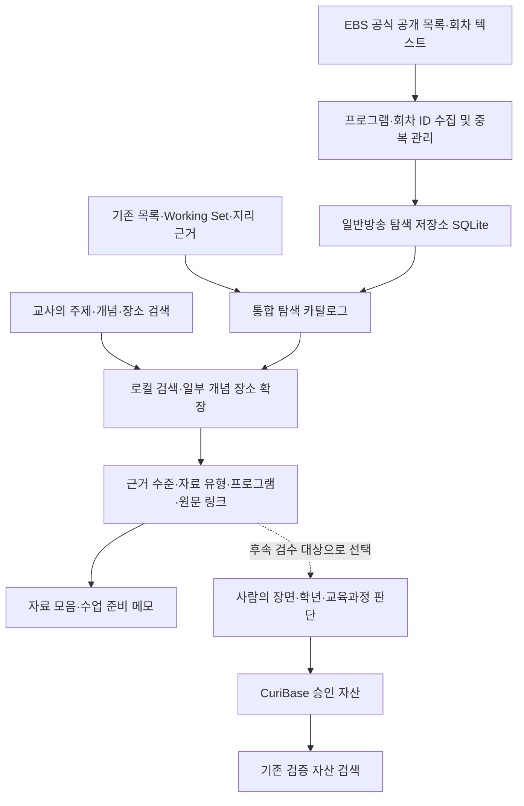

# Curi 전체 task 재구성을 위한 대화 정리

작성일: 2026-09-30  
대상: Pilot 검수 배치 논의부터 일반방송 모집단 확대·검색 반영·1차 마감까지의 대화  
목적: 다음 세션에서 기존 task 전체를 현재 제품 방향에 맞춰 다시 구성하기 위한 인계 자료

이 문서는 대화의 의사결정 요약이며 전체 발언의 축어록은 아니다. **사용자가 요청한 방향, 실제 구현한 결과, 아직 남은 문제, 재구성 제안을 구분한다.** 구현 수치는 1차 마감 보고서를 대조한 스냅샷이다. 이 문서 작성으로 기존 task를 재편하거나 새로운 기능을 구현한 것은 아니다.

## 1. 핵심 방향

**EBS 일반방송 전반에서 실제 회차와 공개 내용 근거를 확보하고, 교사가 수업 주제·개념으로 사례를 찾아 비교·정리할 수 있는 서비스를 만든다.**

초기 소량 데이터는 구조를 잡기 위한 표본이었다. 현재 목표는 그 작은 표본의 검수를 반복하는 데 있지 않다. 충분한 모집단, 정확한 회차 연결, 내용 근거, 교사의 요청을 이해하는 검색, 수업 준비에 재사용할 수 있는 결과를 차례로 갖추는 방향이다.

초등학교 5·6학년은 주요 이용자 문맥으로 유지하되 콘텐츠 수집 대상을 해당 학년용 교과 클립으로 제한하지 않는다. 데이터 수집·검색 가능 상태와 교육과정·학년 적합성 승인 상태를 분리한다. 사람 판단은 마지막 단계로 미루고, 그 전에 자동화할 수 있는 수집·정리·검증·검색·시뮬레이션을 진행한다.

## 2. 사용자가 반복해서 강조한 요구

| 사용자 요구 | task 재구성에서 보존할 의미 |
| --- | --- |
| “일반방송을 승인 배치 주력으로” | 교과연계 클립 중심의 소량 배치에서 벗어나 일반방송 사례를 중심에 둔다. 이후 논의에서는 승인 전에도 출처 기반 탐색이 가능하도록 발전했다. |
| “사람 25건의 검수는 매우 부담이 되고, 직접 태깅은 어려운 상황” | 검수량을 채우거나 사용자가 직접 교육과정 태그를 만드는 일을 개발의 선행 조건으로 삼지 않는다. |
| “너무 빨리 api연결을해서 데이터셋 구축전에 토큰소모” | 데이터·근거·검색 기준을 먼저 마련한다. API 연결 자체를 진척으로 보지 않고 반복 호출·재처리 비용을 억제한다. |
| “동고서저 … 국내 지형이 나오고 관련 지명들을 표출하고 … 연계된 클립들을 추천” | 교과 강좌명 일치보다 개념→실제 지형·장소→방송 사례를 따라가는 탐색 경험을 제공한다. |
| “EBS 초등쪽으로 치우친다면 초등페이지에서 검색하는 이상의 의미가 없습니다” | 여러 일반방송에 흩어진 사례를 찾아 비교하는 것이 핵심 차별성이다. |
| “초기 설계의도에서 데이터를 작게 가져간건 데이터 구조를 잡기위해서” | 144건 등 초기 수량을 제품의 목표 규모나 지속적인 수집 상한으로 고정하지 않는다. |
| “프로그램-회차기준으로 적어도 5천건이상 … 다다익선” | 실제 회차 단위의 모집단을 확대한다. 5,000건은 첫 확보 목표이며 상한이 아니다. |
| “판단사항은 제일 나중으로 미루고 task도 모두 정본화” | 기술 작업과 사람의 승인·적합성 판단을 분리하고, task의 상태·선행 관계를 현재 방향에 맞춰 정리한다. |
| “다시한번 크리틱 1회 후 1차 마무리” | 무한한 추가 개선 대신 범위를 정해 점검·수정·검증하고 완료·미완료를 명확히 남긴다. |

## 3. 대화가 전개된 과정

### 3.1. Pilot 25건 검수에서 시작

처음에는 `task-02-10-review-batch-a.md`를 진행하고 승인할 25건을 준비하는 것이 요청이었다. 사용자는 준비 자료가 교과연계 클립에 치우쳤다고 지적했고, 혼합 배치로 바꾼 뒤에도 비율이 높다고 판단했다. 이어 일반방송을 주력으로 삼도록 요청했다.

검수를 위해 공개 EBS 텍스트를 함께 제공하고 표 형태로 볼 수 있게 해달라는 요청도 있었다. 하지만 일반방송이 계속 보류되거나 승인하기 어려운 상태로 나타났다. 사용자는 이 문제가 초등 5·6학년으로 시작한 범위 설정, 작은 모집단, 교육과정 직접 매핑을 전제한 구조에서 비롯된 것은 아닌지 검토를 요청했다.

**이 단계의 교훈:** 승인 배치의 구성을 바꾸는 것만으로 원천 자료 부족과 사용성 문제가 해결되지는 않는다. 공개 내용 근거가 부족한 상태에서 사용자에게 판단을 넘기면 검수는 사실상 새 데이터 작성 작업이 된다.

### 3.2. 검수·태깅·API 비용을 개발 흐름의 문제로 제기

사용자는 콘텐츠 매핑이 모두 N으로 나오는 것처럼 느껴지는 상황, 25건 검수 부담, 직접 태깅의 어려움, 데이터셋 구축 전에 API를 연결해 토큰을 소비한 문제를 함께 제기했다.

이후 방향은 기존 검수·저장 기반을 폐기하는 전체 재구축보다, **탐색 후보를 확보하고 노출하는 경로를 부분 재설계**하는 쪽으로 정리됐다. 검수 승인 전에도 공식 출처를 가진 자료를 탐색할 수 있게 하고, 교육과정 직접 연계 승인은 별도 경로로 유지했다.

### 3.3. ‘동고서저’로 원하는 제품 경험을 구체화

사용자가 원하는 것은 “동고서저”를 입력했을 때 만점왕 강좌가 우선 나오는 경험이 아니었다. 국내의 동쪽 산지·서쪽 평야를 이해할 수 있는 지형과 지명을 보여주고, 그 장소와 연결된 방송 자료를 찾는 경험이었다.

이에 따라 개념·장소 관계, 관계의 출처, 실제 회차의 제목·소개문을 분리해 다루는 탐색 경로를 만들었다. 지명이 있다는 이유만으로 해당 지형을 설명하는 자료라고 판정하지 않도록 했다.

### 3.4. 현업 실용성과 제출 가능한 수준을 요구

사용자는 현재 144건으로 현업에서 반복적으로 쓸 수 있는지 냉정하게 평가하고, 사람이 판단할 부분은 뒤로 미룬 채 로컬 시뮬레이션을 거쳐 제출 가능한 품질로 개선해달라고 요청했다.

출처 기반 탐색, 자료 모음, 수업 준비 메모 다운로드, 유료 API 기본 차단, 로컬·브라우저 검증을 갖춘 Curi 0.2가 만들어졌다. 다만 로컬 시연 가능 상태를 현업 효용이나 교육적 적합성 검증 완료로 표현하지 않았다.

### 3.5. 원문 링크와 다운로드 출처의 미스매핑 발견

사용자는 ‘EBS 원문보기’가 해당 프로그램과 무관한 페이지로 이동한다고 지적했다. 이후 내려받은 메모의 ‘수집 당시 출처’와 ‘근거 페이지’도 잘못 연결된다고 확인했다.

문제는 URL이 열리는지뿐 아니라 **해당 콘텐츠가 선택된 페이지인지**였다. 특히 강좌 목록 주소만으로는 특정 클립을 식별할 수 없었다. 개별 클립·회차 ID와 도착 제목을 대조하고, 확인 수준에 따라 회차 바로가기·목록·제목 검색을 구분하는 방향으로 수정했다. 모음 내보내기에서도 최신 링크를 조회하도록 연결했다.

**보존할 기준:** 화면 링크를 고쳤다고 다운로드 링크까지 고쳐졌다고 가정하지 않는다. 이미 내려받은 파일은 새로 내려받기 전까지 자동 갱신되지 않는다.

### 3.6. 자료·시나리오·프로그램 범위 확대

사용자는 자료 수와 예시 시나리오가 적다고 지적하고, 초기 소량 데이터는 구조 검증용이었다고 명확히 설명했다. 홈페이지에서 확보할 수 있는 프로그램·회차 기준으로 최소 5,000건 이상을 요구했다.

딩동댕 계열 방송에도 참고할 주제가 있는지 질문하며 어린이 방송을 포함한 폭넓은 일반방송 활용 가능성을 열어두었다. 다만 해당 프로그램의 실제 회차 확보까지 완료된 것은 아니다.

30개 가상 수업 시나리오를 기준선으로 만들고, 일반방송 확대를 설계한 뒤 실제 수집·검색 반영까지 진행했다. 초등 5·6학년이라는 이용자 문맥과 수집 범위를 구분한 것이 중요한 변화다.

### 3.7. 실제 첫 페이지 반영과 1차 마감

사용자는 `127.0.0.1:3317`의 동고서저 검색 `page=1`에서 변화가 잘 보이지 않는다고 지적했다. 설계·데이터 파일만 갱신하는 것이 아니라 사용 중인 서버와 실제 검색 화면에 반영되는지 확인할 필요가 있었다.

일반방송 수집물을 홈페이지 검색에 연결하고, 프로그램 조건·원문·모음·메모를 검증했다. 추가 크리틱 1회에서는 제목 반복의 근거 수준, 옛 상품 목록 재생시간, 일반방송 예시의 가시성을 수정했다. task 52개를 현재 진행 정본에 연결하고 사람 판단을 마지막 단계로 미룬 상태로 1차 작업을 마쳤다.

## 4. 현재 합의된 제품·작업 원칙

1. **일반방송을 주력 모집단으로 삼는다.** 교과 클립은 필요할 때 설명을 보완하는 자료이며, 이를 늘려 일반방송 확대 목표를 대체하지 않는다.
2. **이용 학년과 수집 범위를 분리한다.** 초등 이용자에게 쓸 수 있는 사례는 일반 다큐·기행·사회·과학·생활·문화 방송에도 있을 수 있다. 수집만으로 학년 적합성을 승인하지 않는다.
3. **출처 기반 탐색과 승인 자산 검색을 분리한다.** 승인되지 않았다는 이유만으로 모든 콘텐츠 탐색을 막지 않고, 탐색된다는 이유로 승인 자산으로 승격하지 않는다.
4. **원문에 있는 사실과 추정·생성을 구분한다.** 공개 텍스트가 없으면 없다고 표시한다. 생성 소개문·확인하지 않은 지명 관계·타임코드로 빈칸을 채우지 않는다.
5. **개별 회차 식별과 도착 페이지 일치를 확인한다.** 프로그램 홈·강좌 목록·상품 목록·실제 회차를 같은 단위로 취급하지 않는다.
6. **데이터·근거·로컬 검색을 먼저 구축한다.** 서비스 유료 API는 기본 차단하며, 모델·비용 선택은 실제 필요와 평가 자료가 준비된 뒤 판단한다.
7. **사람 판단을 마지막에 둔다.** 자동화할 수 있는 수집·정리·오류 확인·검증 자료 준비를 먼저 끝낸다. 사람이 하지 않은 검수·시청·평가를 수행했다고 기록하지 않는다.
8. **실사용 흐름을 검증한다.** 검색 결과 수뿐 아니라 필터·페이지 이동·원문 이동·자료 모음·다운로드·오류 복구·모바일까지 확인한다.
9. **수량과 품질을 별도로 보고한다.** 회차 ID, 제목 그룹, 소개문 보유, 링크 대조, 승인 자산 수를 섞지 않는다.
10. **완료 범위를 고정하고 근거를 남긴다.** 로컬 구현 완료, 사람 판단 대기, 후속 기술 작업, 외부 배포·제출을 구분한다.

## 5. 실제 구현한 구조



| 경로·산출물 | 현재 역할 |
| --- | --- |
| `/`, `public/discover.html` | 출처 기반 탐색 홈. 승인 전 자료를 근거 수준과 함께 탐색 |
| `/index.html` | 기존 승인 자산 검색. 새 수집물을 자동 승인해 넣지 않음 |
| `/curimap.html`, `/review.html` | 기존 연계·검수 관리. 유료 초안 생성은 기본 차단 |
| `server/data/broadcast-catalog.sqlite` | 새 일반방송 회차·목록 체크포인트·개별 링크 대조·FTS 색인 |
| `server/data/curi-store.json` | 기존 Working Set·검수·승인 자산. 이번 확대·검증에서 불변 확인 |
| `server/broadcast-collect.mjs` | 공개 목록 수집, 중단 재개·갱신·상세 보강을 명시적으로 실행 |
| `server/discovery-catalog.js`, `server/discovery-search.js` | 자료 통합·변경 감지·로컬 검색·조건·페이지 처리 |
| `server/source-links.js` 및 회차 DB의 대조 기록 | 콘텐츠와 이동 URL의 확인 수준 관리 |
| `server/data/classroom-scenarios.json` | 실제 콘텐츠와 별개인 30개 가상 수업 요구 |

현재 제품 질의는 캐시된 메모리 카탈로그를 검색한다. SQLite FTS 색인을 생성했다고 해서 한국어 검색이 이미 FTS·범용 의미 검색으로 전환됐다는 뜻은 아니다. 개념·장소 확장은 동고서저·화산 지형·해안 지형 3종이며, 그 밖의 검색은 제목·공개 소개문 단어 조건 중심이다.

## 6. 1차 마감 시점의 실제 수치

### 6.1. 자료 단위별 집계

| 항목 | 수 | 해석 |
| --- | ---: | --- |
| 신규 일반방송의 공식 회차 ID | 5,548 | 영상 파일을 내려받은 수가 아니라 공식 메타데이터의 회차 식별 수 |
| 합본·재방송 의심 표제를 제외한 회차 ID | 5,544 | 표제 규칙에 따른 보수적 구분. 내용 중복 전수 판정 아님 |
| 위 회차의 프로그램·제목 고유 조합 | 5,424 | 같은 제목의 여러 ID를 별도로 점검하기 위한 집계 |
| 화면의 신규 일반방송 제목 그룹 | 5,424 | 검색에서 같은 프로그램·제목은 대표 1건 표시. 원본 ID는 보존 |
| 신규 일반방송 프로그램 수 | 9 | EBS 전체 프로그램·전체 과거 회차를 수집한 상태는 아님 |
| 새 회차 중 소개·설명 필드 보유 | 3,526 | 짧은 문구·제목 반복 포함. 충분한 내용 근거 확보 수와 다름 |
| 새 회차 중 설명 필드 없음 | 2,022 | 후속 보강 대상 |
| 새 회차의 개별 도착 ID·제목 대조 | 200 | 목적 표집이며 재생·학년 적합성 검증 아님 |
| 전체 홈페이지 개별 자료 | 5,587 | 기존 자료 포함·화면 중복 제거 후 |
| 별도 프로그램·회차 탐색 목록 | 444 | 개별 자료 수에 포함하지 않음 |
| 전체 검색 목록 | 6,031 | 개별 자료 5,587 + 목록 444 |
| 전체 화면에서 개별 페이지 대조 자료 | 341 | 기존 클립·PD로그와 새 회차를 합친 표시 기준 |
| 기존 Working Set / 승인 고유 콘텐츠 | 144 / 4 | 탐색 모집단과 별개. 이번 수집으로 승인 수를 늘리지 않음 |

프로그램 분포는 지식채널e 2,796, 한국기행 1,261, 다큐프라임 629, 세계테마기행 469, 고향민국 344, 곽준빈의 세계 기사식당 24, 세계 극한직업 12, 여행본색 8, 맛터사이클 다이어리 5건이다. 지식채널e가 약 절반을 차지하므로 초등 클립 편중은 줄었지만 공급원 균형 문제가 모두 해결된 것은 아니다.

### 6.2. 검색·검증 결과

| 측정 | 확대 전 | 확대 후 |
| --- | ---: | ---: |
| 동고서저 검색 결과 | 4 | 9 |
| 동고서저 결과 중 개별 도착 대조 자료 | 1 | 8 |
| 핵심어로 후보가 나온 수업 시나리오 | 23/30 | 27/30 |
| 요청 문장을 그대로 넣어 후보가 나온 시나리오 | 14/30 | 14/30 |
| 핵심어 결과에 개별 페이지 대조 후보가 있는 시나리오 | 18/30 | 22/30 |
| 시나리오 핵심어 전체 결과의 고유 자료 | 31 | 154 |

1차 마감에서 로컬 11개·브라우저 14개 흐름, 출처 링크 계약, 수집물 무결성·중복 적재·실패 롤백·본문 보존, 500/2,000/5,000건 규모 검증을 통과했다. 해당 수집·검색·시뮬레이션의 **서비스 유료 API 호출은 0회**였다. 이전 개발 전체의 API 비용 또는 개발 에이전트 토큰 소비가 0이라는 뜻은 아니다.

이 측정은 검색 후보의 존재와 기능 동작을 확인한 것이다. 정답률·교사 만족도·수업 준비 시간 절감·교육과정 적합성의 실측으로 해석하지 않는다.

## 7. 해결한 문제와 남은 문제

| 구분 | 1차에서 해결·개선한 내용 | 남은 내용 |
| --- | --- | --- |
| 모집단 | 초기 144건 중심에서 5,000건 이상 일반방송 회차를 탐색에 연결 | 프로그램·분야 편중, 더 오래된 회차, 어린이·문화·과학 등 추가 공급원 |
| 내용 근거 | 공식 공개 텍스트 저장, 제목 반복은 제목 근거로 구분 | 소개문 없는 회차와 너무 짧은 설명의 보강, 실제 장면 근거 |
| 원문 이동 | 클립·회차 ID 대조, 설악산·김제 실제 회차 연결, 메모 링크 갱신 | 새 회차 대부분은 목록 제공 URL 단계, 재생·로그인 조건·지속적인 링크 갱신 |
| 검색 | 일반방송 우선 탐색, 프로그램 조건, 일부 개념·장소 연결 | 긴 문장 해석, 학년·주제·목적·제약 분리, 더 넓은 개념·사례 연결 |
| 사용자 경험 | 모음·다운로드·오류 복구·모바일, 일반방송 예시 4개 상시 노출 | 실제 교사 사용에서의 탐색 비용·결과 비교·자료 선택 효용 |
| 비용 | 유료 API 기본 차단, 로컬 검색, 반복 수집·검증 경로 | 유료 모델이 꼭 필요한 작업·효과·호출 예산에 대한 후속 판단 |
| 운영 | 원본 ID 보존, 체크포인트·재실행·실패 처리, 상태 문서 연결 | 자동 예약 수집, 운영 갱신 주기, 더 큰 규모의 지속 운영 |
| 제출 | 로컬 시연 가능한 흐름과 검증·크리틱 기록 | 외부 배포, 실제 시연 영상, 최종 보고서·ZIP·제출 |

냉정한 현재 판정은 **“원문을 비교하고 수업 자료를 모으는 로컬 탐색 시연이 가능하다”**이다. “범용 자연어 추천이 완성됐다”, “5,548개가 모두 수업에 적합하다”, “현업 효과가 입증됐다”는 판정은 아직 할 수 없다.

## 8. 전체 task를 다시 구성해야 하는 이유

이전 task는 `연계 API → 25건 검수 → 추가 검수 → 승인 자산 100~150건 → 검색 평가`의 순서에 크게 의존했다. 지금의 제품 방향은 `넓은 원천 수집 → 근거·링크 품질 → 교사 탐색 → 비교·재사용 → 기술 검증 → 마지막 사람 판단`에 가깝다.

1차 마감에서는 52개 task에 현재 정본 링크를 넣고 주요 충돌 설명을 갱신했다. **52개 task의 내용·분류·번호·선행 관계를 전면 재편한 것은 아니다.** 따라서 다음 작업에서는 단순히 완료 표시를 정리하는 것을 넘어 실제 task 구성을 다시 설계할 필요가 있다.

재구성 시 확인해야 할 구체적인 항목:

- `02-10·02-11·02-12`의 25건·50건·100~150건 사람 검수 목표가 기술 개발의 필수 선행 조건으로 남아 있는지.
- `03-01` 유료 모델 비교 완료가 `03-02` 검색 개선의 선행 조건으로 남아 있는지. 현재는 유료 API 없이 먼저 개선할 작업이 있다.
- `02-10A`의 20건·2시간 초기 조사 상한과 자료 타당성 판단이 실제 5,548건 확보 이후 상태와 맞는지.
- 선택 task인 프로그램 필터처럼 새 탐색 화면에 이미 일부 구현된 기능이 기존 승인 자산 검색의 미구현 요구와 섞여 있는지.
- 30개 수업 시나리오, 기존 알려진 항목 검색 평가, 운영 측정 task 사이에 중복과 누락이 있는지.
- 과거의 144·165·609건과 현재 탐색 규모가 같은 시점·같은 단위처럼 쓰이는지.
- 초기 날짜·예상 시간·모델 권장이 현재 작업의 확정 일정이나 실행 조건처럼 남아 있는지.
- 기술 검증 완료와 사람 적합성 확인을 같은 체크박스로 취급하는지.

과거 구현 이력·공식 교육과정 원문·검수 기록·승인 저장소는 보존할 자산이다. 번호를 바꾸더라도 과거 작업과 새 task의 대응 관계를 남겨야 한다.

## 9. 새 task 구성에 반영할 작업 묶음 제안

아래는 대화의 방향을 실제 task로 옮기기 위한 **재구성 초안**이다. 새 번호·기간·세부 완료 기준이 이미 확정됐다는 뜻은 아니다.

| 순서 | 작업 묶음 | 핵심 산출물·완료 기준의 방향 |
| --- | --- | --- |
| 1 | 현재 자산·요구·task 대조 | 구현·미구현·중복·이월·폐기 후보를 구분하고 이전 task와 새 task의 대응표 작성 |
| 2 | 모집단 확대와 내용 근거 보강 | 회차 ID·소개문·프로그램 다양성·출처 추적·증분 수집을 별도 지표로 관리 |
| 3 | 링크·메타데이터 품질 | 실제 회차 일치, 제목만 있는 항목 구분, 변경 감지, 화면·모음·내보내기의 일관성 |
| 4 | 교사 요청 해석과 사례 검색 | 주제·장소·교과 문맥·제약 분리, 자료 부족과 해석 실패 구분, 개념·사례 연결 확장 |
| 5 | 수업 준비 흐름 | 검색→비교→원문 확인→모음→메모의 사용성 및 지원 범위 안내 |
| 6 | 로컬 평가·안정화·시연 준비 | 시나리오 전후 비교, 무관 후보·빈 결과·성능·오류 복구·비용 보호, 재현 가능한 실행 |
| 7 | 마지막 사람 판단과 제출 확정 | 준비된 근거를 토대로 학년·장면·교육과정 적합성, 필요 시 유료 모델·비용, 배포·제출 승인 |

사람 판단을 마지막으로 미룬다는 것은 개발 중 사실 확인이나 자동 검증을 생략한다는 뜻이 아니다. **기술적으로 확인할 수 있는 내용은 먼저 확인하고, 교육적 판단이 필요한 부분만 구분해 남긴다.** 제출용 문서·데모의 초안 준비는 가능한 범위에서 먼저 하고, 사람이 수행해야 하는 확인·녹화·승인을 대신 완료하지 않는다.

## 10. 다음 재구성 작업에 넘길 요청문

```text
docs/CONVERSATION_SUMMARY_FOR_TASK_REDESIGN.md와 현재 코드·데이터·PLANS를 바탕으로
Curi의 전체 task 구성을 재설계해주세요.

1. 일반방송 중심의 폭넓은 회차 모집단과 교사의 개념·사례 탐색을 제품 중심에 두세요.
2. 초등 5·6학년은 이용자 문맥이며 콘텐츠 수집 범위를 제한하는 조건이 아닙니다.
3. 출처 기반 탐색과 교육과정 승인 자산을 분리하고, 사람 판단은 마지막 단계로 미루세요.
4. 25건 검수·직접 태깅·유료 API 연결을 기술 작업의 선행 조건으로 두지 마세요.
5. 기존 구현과 승인 이력은 보존하고, 완료·미구현·중복·이월 항목을 실제 코드 기준으로 대조하세요.
6. 기존 task와 새 task의 대응표, 실행 순서·의존성, 작업별 산출물·완료 기준을 작성하세요.
7. 회차 수·내용 근거·링크 일치·검색 품질·사용성·비용을 별도로 측정하도록 구성하세요.
8. 실제 구현·로컬 검증과 사람의 교육적 적합성 승인·외부 제출을 구분하세요.
9. 현재 구현된 프로그램 필터·시나리오·수집·원문 보정이 새 계획에서 중복 개발되지 않게 하세요.
10. 문서 재구성과 기능 구현 범위를 분명히 하고, 미실행 사람 확인을 완료 처리하지 마세요.
```

## 11. 근거 문서와 이어서 볼 파일

| 문서·파일 | 확인할 내용 |
| --- | --- |
| [PLANS](PLANS.md) | 현재 상태 정본, 52개 task 목록, 기술 작업과 최종 사람 판단의 구분 |
| [일반방송 수집·검색 반영](BROADCAST_CORPUS.md) | 실제 회차 집계·공급원·재실행·검색 반영·한계 |
| [30개 수업 시나리오](CLASSROOM_SCENARIOS.md) | 문장 검색과 핵심어 검색의 차이·남은 공백 |
| [확대 전 측정](classroom-before-expansion.json), [확대 후 측정](classroom-simulation.json) | 23→27/30·14→14/30의 비교 근거 |
| [로컬 검증](local-simulation.json), [브라우저 검증](local-browser-simulation.json) | 실제 실행 사례와 확인 범위 |
| [수집물·규모 검증](broadcast-simulation.json) | 무결성·임시 DB 재적재·검색 규모·저장소 불변 |
| [첫 사용성 크리틱](USABILITY_CRITIQUE_01.md), [마감 크리틱](USABILITY_CRITIQUE_02.md) | 원문 미스매핑과 사용성 개선의 경과 |
| [1차 마감 task](../Tasks/task-02-10f-first-closeout.md) | 이번 마감 범위와 미실행 사람 확인 |
| [일반방송 확대 설계](DATA_EXPANSION_5000.md) | 수집 전 설계 의도. 최신 실행 결과는 수집 실측 문서를 우선 |
| [개념·장소 수정 설계](../planning/concept-place-discovery/PLAN.md) | 부분 재설계의 이유와 초기 가설 |
| [초기 현업 실용화 평가](../planning/concept-place-discovery/READINESS.md) | 144건 시점의 비판 근거. 현재 규모로 오인하지 않을 것 |

마지막으로 확인한 로컬 사용 주소는 `http://127.0.0.1:3317/`이다. 서버 실행 여부는 다음 세션에서 다시 확인한다. 문서의 수치는 데이터가 갱신되면 재집계하며, 이번 요약을 작성하면서 외부 수집·유료 API 호출·사람 검수는 수행하지 않았다.
