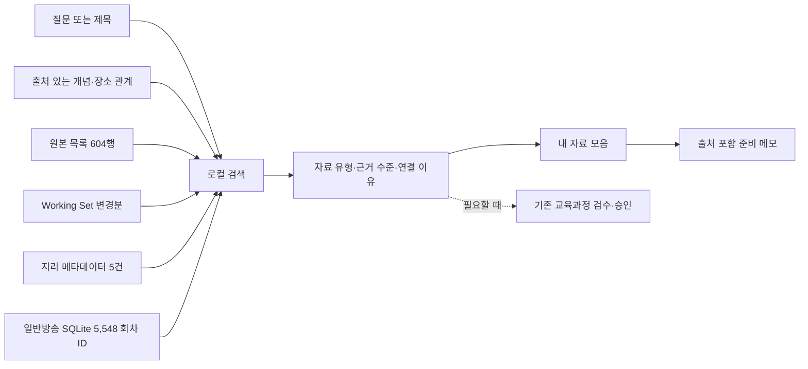

# Curi 0.2 로컬 사용·시연 안내

2026-09-28. 출처 기반 콘텐츠 탐색과 수업 준비 메모를 사용할 수 있는 로컬 버전이다. 프로그램·시뮬레이션·시연 안내를 제공한다. 외부 배포·제출 ZIP·영상·최종 보고서는 아직 제작하지 않았다.

2026-09-30 1차 마감: [일반방송 수집·검색 반영](BROADCAST_CORPUS.md)으로 5,548 회차 ID를 추가했고, 현재 화면은 개별 자료 5,587·목록 444다. 동고서저는 9건이며 설악산·김제는 실제 회차로 연결된다. 아래 609·165건 및 소개·상품 목록 설명은 최초 구현 시점의 이력이다. 최신 실측은 `local-simulation.json`, `classroom-simulation.json`, `broadcast-simulation.json`을 따른다. [추가 크리틱 1회](USABILITY_CRITIQUE_02.md)를 반영했으며 사람 판단은 최종 단계로 이월했다.

후속 수정: [사용성 크리틱 1회와 원문 링크 보정](USABILITY_CRITIQUE_01.md). 개별 클립·회차 142건의 도착 페이지 일치를 확인하고 소개·상품·강의 목록과 구분했다. 아래 원문 접근 미확인 설명 중 해당 147건은 대조 기록으로 갱신되며, 실제 재생·학년 적합성은 계속 미확인이다. 개별 페이지 확인 조건을 켜면 소개문·목록을 제외할 수 있다.

## 바로 실행

Node.js 24.18 이상, 프로젝트 루트에서 실행한다. 기존 설치 환경에서는 새 패키지가 필요 없다. 최초 설치 환경에서는 `npm ci`를 먼저 실행한다.

```bash
npm start
```

터미널의 주소(기본 `http://127.0.0.1:3000`)로 접속한다. 기본 포트가 사용 중이면 `PORT=3317 npm start`를 사용한다. 새 탐색 화면은 API 키·25건 검수·임베딩 모델 다운로드 없이 동작한다. EBS 원문 열기는 인터넷 연결이 필요하다.

## 달라진 흐름



- `/`: 출처 기반 콘텐츠 탐색. 승인 여부를 검색 진입 조건으로 요구하지 않는다.
- `/index.html`: 기존 검증 자산 검색. 기존 Gate와 로컬 임베딩을 유지한다.
- `/curimap.html`, `/review.html`: 기존 연계·검수 관리. 사람 승인 기록을 대신 생성하지 않는다.
- 동고서저·화산 지형·해안 지형은 명시적 개념·장소 관계를 사용한다. 나머지는 제목·공개 소개문 단어 검색이다. 범용 자연어 의미 추론을 주장하지 않는다.
- 순위는 개념 관계, 일반방송 여부, 소개문 근거, 제목 일치를 반영한다. 교육적 정답 확률이나 학년 적합성 점수가 아니다.
- 미보유 조건을 다른 결과로 채우지 않는다. `동고서저 뉴질랜드`도 빈 결과로 처리한다.

## 데이터 규모

구현 시점 스냅샷이다. `npm run simulate`와 화면에서 현재 집계를 확인한다.

| 구분 | 수 | 의미 |
| --- | ---: | --- |
| 검색 목록 | 609 | 원본 604행 + 새 지리 메타데이터 5건, ID 중복 제거 |
| 개별 자료 | 165 | 일반방송 94회차 + 교과 클립 68 + 짧은 강의 3 |
| 프로그램·회차 탐색 목록 | 444 | 프로그램 묶음 421 + 개별 회차 식별이 부족한 seed 23 |
| 소개문 근거 보유 | 109 | 전체 유형 중 소개문/소개 요약이 있는 자료. 시청 검증 수가 아님 |
| 기존 Working Set | 144 | 기존 검수 입력 저장소 |
| 기존 검색 투영 고유 콘텐츠 | 4 | 검증 자산 검색에 저장된 고유 콘텐츠 |
| 개념 확장 | 3종 | 동고서저·화산 지형·해안 지형 |

609편을 바로 재생할 수 있다는 의미가 아니다. 개별 자료에도 목록 링크와 제목만 확보한 자료가 포함된다. 전 교과에서 반복 사용할 추천 서비스가 완성됐다고 보고하지 않는다.

## 3분 시연

1. 홈에서 `동고서저 관련 클립을 추천해줘`를 검색한다. 설악산·김제 연결과 일반방송 2건, 짧은 강의 1건, 교과 클립 1건을 확인한다.
2. `김제`를 선택한다. **EBS미디어 상품 목록·제목 근거** 단계임을 설명한다. 무료 클립 또는 평야 장면 검증으로 소개하지 않는다.
3. `모으기` → `내 자료` → `준비 메모 내려받기`로 질문·연결 이유·출처·미확인 범위가 담긴 Markdown 파일을 받는다.
4. `화산 지형`, `해안 지형`으로 다른 개념 경로를 확인한다. `백두대간`·`재활용`은 기존 일반방송의 공개 텍스트 검색 사례다.
5. `양자중력`의 빈 결과를 보여준다. `전체 목록`과 `프로그램·회차 목록`을 전환해 자료 단위를 설명한다.
6. CuriMap에서는 유료 실행이 꺼져 있음을 확인한다. 사람 검수는 이후 필요한 자료에 한해서 진행한다.

## 출처와 확인 수준

새 자료는 공식 페이지의 검색 색인에 나온 제목·소개를 짧게 요약했다. 원문 직접 열기가 도구에서 실패한 경우도 있어 현재 접근 가능성은 미확인으로 기록했다. 자막·영상·타임코드를 생성하지 않았다.

| 자료 | 출처 | 확보 범위 |
| --- | --- | --- |
| 산지·평야 비교 | [한국민족문화대백과사전 · 평야](https://encykorea.aks.ac.kr/Article/E0059933) | 산지·평야 분포와 김제평야 관계 요약 |
| 한국기행 설악산 회차 | [EBS 방송 소개](https://about.ebs.co.kr/board/bbs?boardId=31&boardTypeId=1&cmd=view&no=3&option=respond&pageNo=4&postId=10001569455&searchCondition=title&searchKeyword=) | 검색 색인의 회차 제목·산 경관 소개 |
| 한국기행 김제 회차 | [EBS미디어 상품 목록](https://www.ebsmedia.net/shop/shopdetail.html?branduid=705349) | 제목·목록 시간. 유료 상품이며 무료 재생 링크가 아님 |
| 국립공원 강의 3건 | [EBS 중학 강좌](https://mid.ebs.co.kr/course/view?courseId=100005142&left=grade) | 검색 색인의 제목·소개·시간. 초등 적합성 미판정 |

서쪽 평야는 실제 장면과 내용 근거가 부족하다. 원래 02-10A의 ‘근거 있는 자료 3건·지형 사례 2종·식별 가능한 실제 클립 1건’ 확보 Gate는 완료 처리하지 않았다. 이번 버전은 자료 부족을 표시하며 탐색하는 도구다. 일반방송 클립 추천의 실용성을 높이려면 개별 재생 URL·내용 근거 확보가 다음 핵심 과제다.

## 비용·저장·확장

- 새 검색은 로컬 파일과 규칙만 사용하고 외부 생성·임베딩 API를 호출하지 않는다.
- `CURI_ALLOW_PAID_API`가 정확히 `true`일 때만 기존 유료 초안 생성이 허용된다. 기본은 차단이며 버튼과 서버가 함께 막는다.
- 같은 입력·공식 기준·프롬프트 버전의 성공 또는 보류 결과는 재사용한다. 근거가 바뀌면 기존 횟수 제한 안에서 다시 검토한다.
- 내 자료는 브라우저 저장소에 남는다. 저장 공간 사용이 불가능하면 안내하고 세션 내 모음·다운로드를 제공한다. 브라우저 데이터 삭제 시 사라지므로 메모로 내보낼 수 있다.
- 증분 가져오기의 신규·변경·비활성 자료는 다음 검색부터 반영한다. 개념 관계 확장은 `server/data/discovery-geography.json`에 근거를 추가해야 한다.

## 검증과 재현

```bash
npm run simulate
```

임시 localhost 서버로 HTTP를 확인한 뒤 종료한다. 실제 검수 저장소는 읽기만 한다.

- 검색·출처·빈 결과·페이지·증분 반영·HTTP·유료 차단·저장소 불변: **11개 시나리오 통과**. [결과 JSON](local-simulation.json).
- Chromium: **9개 시나리오 통과**, 페이지 오류 0건. [브라우저 결과](local-browser-simulation.json), [데스크톱](curi-local-desktop.png), [모바일](curi-local-mobile.png).
- 기존 후보 검색·AI 초안 계약·실패 처리·검수·검증 저장·색인·자연어 검색: **검증 스크립트 7개 통과**. AI 응답은 모의 응답이며 실제 API 호출은 없다.
- 처리 시간은 파일 읽기를 포함하며 렌더·외부 EBS 응답은 제외한다. 현재 측정값은 JSON에 기록한다. 교사 시간 절감이나 추천 정확도 측정과 다르다.

브라우저 검증은 Playwright/Chromium이 있는 환경에서 `CURI_TEST_URL=http://127.0.0.1:3317 node server/discovery-browser-check.mjs`로 재현한다. 프로젝트 밖에 설치된 Playwright는 `CURI_PLAYWRIGHT_MODULE`에 `index.mjs` 절대 경로를 지정한다. 제품 사용에는 필요 없다.

## 제출 설명에 사용할 범위

“검수 승인을 기다리지 않고 EBS 원본 목록을 탐색하고, 지원하는 개념에서 장소와 자료 출처를 따라가며 수업 준비 메모를 만들 수 있다. 유료 API를 기본 차단하고 로컬 검색을 재사용한다.”

영상 재생·장면 적합성·교육과정 정확도·교사 체감 유용성은 이번 자동 확인에 포함되지 않는다. 외부 배포와 최종 제출물 제작 전에 실제 자료 사용 가능성과 설명 범위를 대조해야 한다.
