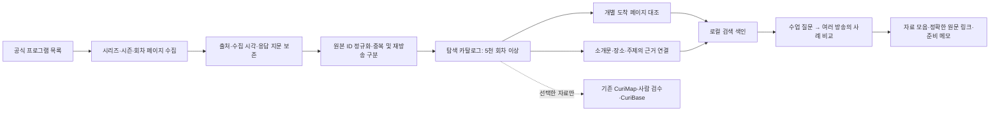

# Curi 모집단 확장 설계 — 일반방송 회차 5,000건 이상

작성: 2026-09-29. 2026-09-30 현재 1차 수집·검색 반영 완료. 9개 프로그램 5,548 회차 ID, 제목 조합 5,424건을 확보했다. 실제 구현·한계·재실행은 [BROADCAST_CORPUS](BROADCAST_CORPUS.md)를 따른다. 아래 본문은 수집 전 설계·기준선이며 미확인·예정 설명을 현재 구현 상태로 해석하지 않는다. 기존 승인 저장소를 이전하지 않고 별도 SQLite 탐색 저장소를 추가했다.

## 결정과 제품의 역할

초기 소량 데이터는 구조·저장·검수 흐름을 검증하기 위한 표본이었다. 이제 일반방송을 중심으로 프로그램→시리즈→회차를 확보하고, 반복 수집 가능한 모집단으로 확대한다. 5,000건은 첫 확보 목표이며 상한이 아니다. 이후 10,000건 이상으로 같은 경로를 재사용한다.

초등 5·6학년은 교사의 검색 문맥이다. 수집 대상을 EBS 초등, 해당 학년 표시 콘텐츠, 교과연계 클립으로 제한하지 않는다. 다큐·기행·사회·경제·역사·과학·생활·문화예술 전반을 수집한다. 교육과정 직접 연계와 학년 적합성은 별도 판단이며, 미판정이라는 이유로 원천 카탈로그에서 탈락시키지 않는다.

Curi의 가치는 여러 방송에 흩어진 실제 사례를 수업 질문으로 찾고, 비교할 자료와 출처 근거를 모아주는 데 있다. 교과 강좌 목록을 다시 보여주는 것만으로는 목표를 충족하지 않는다.

| 교사의 수업 질문 | 제공할 탐색 경험 | 추가로 확보해야 할 근거 |
| --- | --- | --- |
| 동고서저를 실제 국내 풍경으로 설명하고 싶다 | 국내 기행·다큐의 산지와 평야 사례를 구분해 비교 | 해당 회차 소개문에 지형을 다룬다는 근거; 지역 이름만으로 연결 금지 |
| 생산과 소비를 우리 생활로 보여주고 싶다 | 농업·가공·유통·시장 관련 서로 다른 프로그램의 사례 | 과정별 설명과 해당 회차 링크 |
| 기후 변화에 대응하는 사람들을 보여주고 싶다 | 자연현상·생활 영향·대응 사례를 나눠 탐색 | 기후 변화와 단순 계절 날씨의 구분 |
| 같은 주제를 다른 관점에서 토론하고 싶다 | 방송·사례가 다른 후보와 연결 근거를 비교 | 제목 일치보다 내용 근거와 관점 차이 |

위 표는 구현 목표이며 현재 지원을 보장하지 않는다. 데이터 증량과 검색 해석 개선을 각각 측정한다.

## 현황과 왜 기존 가져오기만으로 부족한가

2026-09-29 로컬 파일 기준:

| 항목 | 실제 수 | 해석 |
| --- | ---: | --- |
| 원본 목록 | 604 | 개별 영상과 묶음이 혼재 |
| 다큐프라임 시리즈 / 다큐멘터리K 시리즈 | 409 / 12 | 회차 확장을 시작할 기존 목록; 421편의 영상으로 계산하지 않음 |
| PD로그 회차 / 교과 클립 | 92 / 68 | 기존 개별 자료 |
| 편성·보도 기반 회차 단서 | 23 | 개별 식별자 미확보; 영상 확보 건수 제외 |
| 지리 보강 포함 탐색 개별 자료 | 165 | 회차 94·클립 68·강의 3 |
| 개별 페이지 일치 확인 | 142 | 실제 재생·소개문 대조·수업 적합성과 별개 |
| 기존 Working Set / 검증 검색 고유 콘텐츠 | 144 / 4 | 모집단 확장 목표와 별개의 검수 저장소 |

`server/incremental-ingestion.js`는 신규 콘텐츠마다 검수 대기 상태를 만든다. 이 경로로 5,000건을 일괄 투입하면 검수 병목을 재생산한다. `discovery-catalog.js`는 요청마다 원본 CSV·저장소를 읽어 결합하며, `discovery-search.js`는 전체를 단어 조건으로 검색한다. 규모 확대에서는 별도 탐색 카탈로그·색인이 필요하다. 기존 승인 이력·ID·검증 자산은 보존한다.

[30개 가상 수업 시나리오](CLASSROOM_SCENARIOS.md)의 현재 결과는 요청 문장 14/30, 작성자가 정한 핵심어 23/30에서 후보 반환, 중복 제거 후보 31건이다. 이는 적합성 정확도가 아니다. 7개 핵심어의 빈 결과와 긴 요청 해석 실패를 기준선으로 유지한다.

## 5,000건의 집계 계약

기본 목표는 **프로그램에 귀속되고, 개별 식별자·제목·해당 회차로 연결되는 URL을 확보한 고유 방송 회차 5,000건 이상**이다. 클립·강의는 추가 확보하되 이 목표를 대신 채우지 않는다. 일반방송을 주력으로 하며 초등 교과·유아 프로그램 수량으로 부족분을 채우지 않는다.

다음 숫자를 나누어 보고한다.

1. 발견 목록: 프로그램·시리즈·편성표 단서 등 수집 입구.
2. 고유 회차: 원본 ID와 해당 회차 주소가 확인된 수. 5,000건 기준의 분모.
3. 내용 검색 가능 회차: 회차와 연결된 공개 소개·설명까지 있는 수.
4. 개별 링크 대조 완료 회차: 도착 페이지의 선택 ID·제목을 확인한 수.
5. 활용 확인 회차: 실제 시청·구간·학년 적합성을 사람이 확인한 수. 초기 수집 완료의 필수 조건이 아님.

프로그램 홈, 시리즈 표제, 예고 기사, 상품 목록, 동일 회차의 재방송·여러 URL은 신규 회차 수에 더하지 않는다. 한 회차에서 나온 클립은 부모 회차와 연결해 별도 집계한다. 다른 사이트의 동일 방송은 alias로 연결하되 제목만 같다는 이유로 병합하지 않는다. 식별 충돌은 보류 목록에 남기고 목표 달성 수에서 제외한다.

내용 없는 회차도 카탈로그에 보존하되 ‘제목만 확보’로 구분한다. 확보량을 늘리기 위해 생성한 소개문이나 추정 태그를 EBS 원문으로 채우지 않는다.

## 수집 경로와 현재 확인 수준

아래는 확보량 약속이 아닌 수집 우선순위다. 각 공급원의 실제 고유 회차 수·소개문 확보율·요청당 처리량은 첫 수집 단계에서 측정한다.

| 우선순위 | 공급원·프로그램 | 출발 경로와 확인 사실 | 남은 조사 |
| --- | --- | --- | --- |
| 1 | 다큐프라임·다큐멘터리K | 로컬 원본에 421개 시리즈와 목록 주소 보유 | 시리즈별 회차 목록 전개, 원본 ID, 회차 상세 소개문, 중복 |
| 1 | 한국기행·세계테마기행·고향민국 등 | [세상의 모든 기행](https://home.ebs.co.kr/worldtrip/replay?stepId=01BP0PAPD0000000022)에 프로그램 구분·VOD·검색 경로 확인 | 동적 회차 목록의 페이지 이동과 개별 ID; 과거분의 접근 범위 |
| 1 | 지식채널e | [공식 홈](https://jisike.ebs.co.kr/jisike/index)에 인문·사회·과학·문화예술 분류와 개별 상세 링크 확인 | 다시보기 전체 페이지·고유 회차 수·소개문 |
| 2 | 극한직업·PD로그·역사·과학·생활 다큐 | PD로그 92회차와 75개 도착 페이지 대조 경험 보유; 나머지는 확대 후보 | 프로그램별 현재 공식 주소·목록 형식과 확보율 조사 |
| 2 | 취미는 과학·나의 두 번째 교과서·문화예술·인문 강연 | 일부 프로그램은 원본에 편성·보도 단서만 있음 | 방송 회차와 강의 단위 구분, 회차 식별, 본문 |
| 3 | 딩동댕 딩동댕 등 어린이 방송 | 아래 공식 소개에서 감정·언어 주제 확인 | 신규 프로그램과 이전 프로그램 ID·시즌 구분, 개별 회차 확보 |
| 보조 | EBS 초등·중학 교과 클립 | 기존 클립 68건 및 일부 강좌 목록 보유 | 부족한 설명을 보완할 때 활용; 모집단 주력으로 삼지 않음 |

공식 한국기행의 이전 홈은 현재 기행 통합 페이지로 이동한다. URL이 열리는 것만으로 프로그램·회차 일치를 판정하면 같은 문제가 재발한다. 프로그램 이름·원본 ID·목록의 필터·상세 제목을 함께 확인해야 한다. 웹 도구에서 일부 동적 목록 본문은 확보되지 않았으며, 전체 공급량 5,000건 가능 여부를 이번 조사만으로 확정하지 않는다.

첫 배치는 공급원별로 나눠 처리해 회차가 많은 한 프로그램이 수집 순서를 독점하지 않게 한다. 원천 보존에는 프로그램별 상한을 두지 않는다. 대신 프로그램별 점유율, 분야별 소개문 확보 수, 신규 주제·사례 증가를 계속 보고한다. 공급량이 부족하면 일반방송 공급원을 추가하며 교과 클립으로 수량을 대체하지 않는다.

## 저장·수집 구조

탐색용 SQLite 저장소를 별도로 제안한다. 로컬 Node 환경에서 `node:sqlite`, SQLite 3.53.1, FTS5 지원을 확인했으며, 아직 실제 데이터 전환은 하지 않았다. 운영 UI와 수집기의 쓰기는 분리하고 배치별 트랜잭션·색인 버전으로 일관된 스냅샷을 제공한다. 기존 `curi-store.json`에는 선택한 연계 검수 자료만 보낸다. 검색용 색인을 다시 만들 수 있어야 하며 승인 이력은 이관·재작성하지 않는다.

| 데이터 | 필수 정보·주요 관계 |
| --- | --- |
| Program | 내부 ID, 공식 프로그램 ID·이름, 채널, 현재 공식 홈, 이전 이름·사이트 alias, 공식 분류 |
| Series | 프로그램 ID, 공식 시리즈·시즌 ID·표제; 시리즈가 없는 프로그램도 허용 |
| Episode | 프로그램/시리즈 ID, 원본 식별자 묶음, 제목, 회차 번호·방송일(있을 때), 고유 회차 ID, 재방송/재편집/합본 관계 |
| Clip | 별도 원본 ID, 부모 회차 ID(확인된 경우), 클립 제목·길이·구간(공식 제공된 경우만) |
| SourceObservation | 수집 URL, 최종 URL, 수집 시각, 상태 코드, 문서 지문, 파서 버전, 페이지 내 대상 식별 근거 |
| Evidence | 회차 ID, 출처 observation ID, 본문 필드/구절·위치, 원문 지문, 제목/소개/자막 등 근거 종류 |
| LinkCheck | 대상 ID, canonical URL, 도착 ID·제목, 확인 시각, MATCHED/UNCONFIRMED/MISMATCH/UNAVAILABLE |
| DiscoveryRelation | 주제/개념/지명과 회차의 관계, 근거 ID, 생성 방법·버전, ‘언급’과 ‘설명’의 구분 |
| CrawlRun / Checkpoint | 공급원·프로그램 범위, 페이지/커서, 새 ID 수·중복·실패 수, 마지막 성공 위치, 완료 여부 |

원본 ID는 사이트가 보장하는 범위를 먼저 확인한다. 최소한 공급원 namespace와 공식 ID를 함께 저장하고 필요한 courseId·stepId·lectId도 보존한다. 같은 ID가 다른 namespace에서 충돌하지 않도록 한다. URL 추적 파라미터를 정리하되 clipId·lectId처럼 콘텐츠 선택에 필요한 파라미터를 지우지 않는다. 제목·회차 번호만으로 ID를 만들거나 장르·학년을 추정해 원본 필드로 기록하지 않는다.

## 수집기 동작

1. 공식 페이지에 실제 노출된 프로그램·다시보기 링크를 수집 입구로 등록한다. 본문·공개 목록 응답을 우선하고, 필요한 경우 브라우저로 렌더링한다. 검색엔진 결과는 후보 발견용이며 확보 완료 근거는 공식 페이지다.
2. 프로그램별 최근·과거 목록을 순회하고 페이지/커서와 새 ID를 기록한다. 페이지 반복, 신규 ID 0, 종료 표식을 감지한다. 공개 목록에서 관측하지 않은 임의 ID를 대입해 회차를 생성하지 않는다.
3. 목록에서 식별자·제목·날짜·상세 주소를 먼저 확보하고, 상세 페이지의 소개·길이·분류를 별도 보강한다. 없는 필드는 null과 미확보 사유를 남긴다.
4. 페이지 단위 체크포인트를 남겨 중단 후 재개한다. 같은 원문 지문은 재처리하지 않고 변경된 필드만 갱신한다. 파서 오류와 회차 삭제를 구분한다.
5. 출발 기본값은 호스트별 동시 1요청·요청 사이 최소 1초·timeout 20초·일시 오류 최대 2회 재시도다. 사이트 안내와 응답 상태에 맞춰 더 낮춘다. 429는 Retry-After를 따르고 반복 차단·403·인증 요구는 해당 경로를 중단·기록한다. 로그인 우회·영상 다운로드는 수집 경로에 포함하지 않는다.
6. 매 배치는 명시적 페이지·건수·시간 상한을 갖되, 체크포인트에서 다음 배치로 이어간다. 전체 목표에 도달했다고 추가 가능한 자료를 버리지 않는다. 유료 모델 API 호출은 0회로 유지한다.
7. 부분 수집 결과를 전체 snapshot으로 기존 가져오기에 전달하지 않는다. 한 프로그램의 일부 페이지 누락으로 다른 회차가 비활성화되지 않게 한다. 전체 범위 순회가 완료되었거나 삭제 근거가 있는 경우만 상태를 바꾼다.

공개 메타데이터와 출처를 중심으로 보관한다. 영상·비공개 자막·서명된 스트림 URL은 수집하지 않는다. 원문 공개·재배포 범위는 해당 공급원의 안내를 기록해 전시 범위에 적용한다. 모델 학습을 위한 수집은 이 설계 범위가 아니다.

## 검색·원문·다운로드 계약

- 수집 위치 `collectionUrl`, 개별 이동 주소 `canonicalUrl`, 소개문 근거 `evidenceUrl`을 분리한다. 서로 같은 값으로 일괄 채우지 않는다.
- HTTP 200·페이지 제목만으로 재생 대상 일치를 단정하지 않는다. 가능한 경우 플레이어/상세의 공식 ID와 제목을 함께 확인한다.
- 화면·모음·다운로드는 같은 LinkCheck를 사용한다. 예전 브라우저 모음도 내보내기 시 현재 링크로 갱신한다. 수집 목록을 개별 영상의 근거 링크로 노출하지 않는다.
- 소개문을 보도자료에서 얻었다면 해당 글의 어느 회차를 설명하는지 연결한다. 개별 재생 링크를 확보했다고 소개문 전체가 그 페이지에 있다는 뜻으로 표시하지 않는다.
- 5,000개 행에 즉시 LLM 태깅을 하지 않는다. 공식 분야, 본문 키워드, 출처가 있는 지명·별칭 사전으로 우선 검색하고, 추출한 단어와 문장을 저장한다. 개념→장소와 영상→주제의 근거를 각각 확보한다.
- 로컬 단어 색인과 기존 로컬 의미 검색을 비교한다. 자연어의 주제·활용 목적·길이·자막 조건을 나누고 미지원 조건을 사용자에게 알린다. 조건을 조용히 버리고 성공으로 보고하지 않는다.
- 검색 결과는 주제 근거·원문 연결·중복 제거를 우선하며, 비슷한 관련도의 후보에서는 프로그램과 사례의 다양성을 반영한다. 일반방송이라는 이유만으로 무관한 결과를 올리지 않는다.

## 실행 순서와 완료 기준

| 단계 | 작업 | 종료 시 산출물 |
| --- | --- | --- |
| A · 공급원 전개 | 다큐 421개 시리즈 입구·기행·지식채널e의 목록과 상세 형식 확인 | 프로그램 레지스트리, 실제 고유 ID·소개문·링크 확보율, 실패 사유; 프로그램별 가용량은 확인한 값만 |
| B · 수집 기반 | 탐색 저장소·수집기·체크포인트·중복 처리 구현, 최소 3개 공급원 계열로 작은 실제 배치 실행 | 재실행해도 중복 0, 중단 재개, 기존 승인 저장소 불변, API 0회 |
| C · 누적 확대 | 500→2,000→5,000 고유 회차 순으로 누적 | 각 구간 실제 고유 회차·소개문·일치 링크·프로그램/분야 분포 보고. 숫자 미달 시 확보한 만큼만 보고 |
| D · 수업 탐색 연결 | 새 카탈로그 검색·근거·자료 모음 연결 | 같은 30개 시나리오 재실행, 결과 후보의 프로그램 다양성·중복·해석 실패·미지원 조건 비교 |
| E · 지속 수집 | 신규분 우선 증분 수집과 과거분 추가 | 추가 가능한 회차를 계속 누적; 변경된 본문·링크의 재확인, 배치 오류 추적 |

실제 5,000건 확보 전에는 모집단 확장 완료로 표시하지 않는다. 소개문이 없는 회차 수, 링크 미대조 수를 별도 공개한다. 검색 가능한 자료를 단순 늘렸다는 이유로 수업 적합성을 승인하지 않는다. 조회 지연·색인 생성 시간·저장량은 500/2,000/5,000 스냅샷에서 실측한다. 현재 요청 처리 시간으로 확대 후 성능을 약속하지 않는다.

사람의 5,000건 직접 태깅·일괄 검수는 없다. 기계적 확인은 전수 자동화하고 식별 충돌·근거 모순은 예외 목록으로 분리한다. 사용자에게 교육적 판단을 맡기는 단계는 수업에 실제 사용할 소수 후보와 명시적 교육과정 승인 요청으로 제한한다. 현재 자료 수집을 막는 필수 절차로 두지 않는다.

## 딩동댕 딩동댕의 위치

공식 2026-09-02 소개에는 ‘마음 편’이 질투·불안·억울함 등의 감정을, ‘말놀이 편’이 이야기 문맥에서 관용 표현을 이해하는 내용을 다룬다고 명시되어 있다. 따라서 감정 표현·관점 이해, 관용어·문맥 추론의 후보 공급원으로 볼 수 있다. 이는 프로그램 설명에서 도출한 활용 가설이며 개별 회차의 수업 적합성 승인이 아니다. [EBS 공식 소개](https://about.ebs.co.kr/board/bbs?boardId=31&boardTypeId=1&cmd=view&no=12&option=respond&pageNo=1&postId=30005418675&searchCondition=title&searchKeyword=)

현재 로컬에는 해당 프로그램의 편성 기반 단서 4건만 있으며 개별 회차 확보 수에는 포함하지 않는다. 이전 [딩동댕 유치원 홈](https://home.ebs.co.kr/dingdongdang/main)은 이전 제목·회차를 보여주므로 신규 프로그램의 정확한 다시보기 주소로 간주하면 안 된다. 프로그램 개편·이름 변경·코너와 회차의 관계를 따로 확인한다.

이 프로그램을 제외할 이유도, 모집단 주력으로 삼을 이유도 없다. 일반방송의 사회·지리·경제·환경·과학·문화 사례를 폭넓게 수집하는 가운데 어린이 방송의 유용한 주제도 함께 발견하는 방향이다.

## 기존 설계와의 관계

이 문서는 사용자의 모집단 확대 요청을 반영하여 기존 ‘동고서저 한 경로·20건/2시간 조사’와 ‘교과·학년 중심 수집’의 확장 제약을 후속 작업에 적용하지 않는다. 기존 타당성 실험과 미충족 이력은 보존한다. 전 학년의 공식 교육과정 매핑 구현까지 함께 확정하는 것은 아니다.

초기 증분 수집·승인 저장 기반을 모두 버리는 전면 재개발은 필요 없다. **원천 탐색 카탈로그와 수집 규모를 확장하고, 기존 검수 시스템은 선택적 후속 경로로 재사용한다.** 25건 승인 목표보다 회차 확보·정확한 출처·내용 검색을 먼저 진행한다. 수집 가능량과 처리량 실측 전에는 완료 날짜나 건당 비용을 고정하지 않는다.
