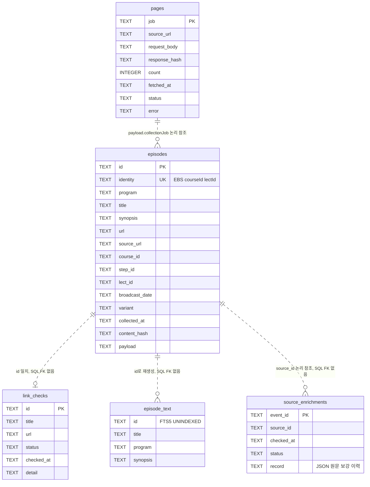
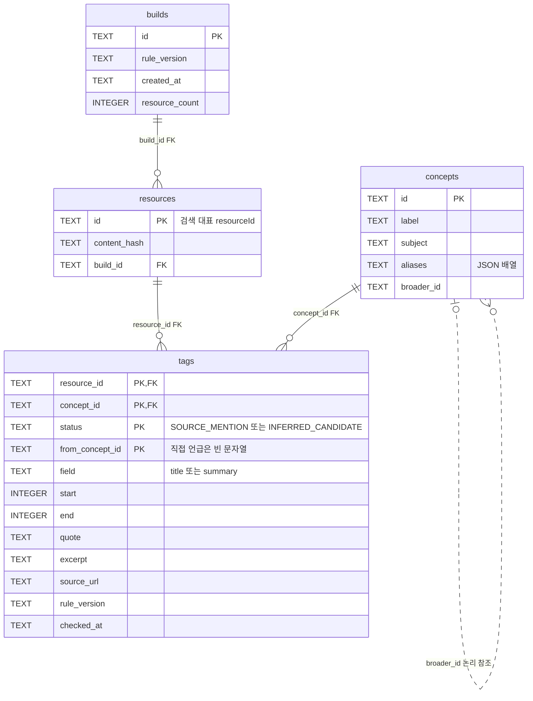
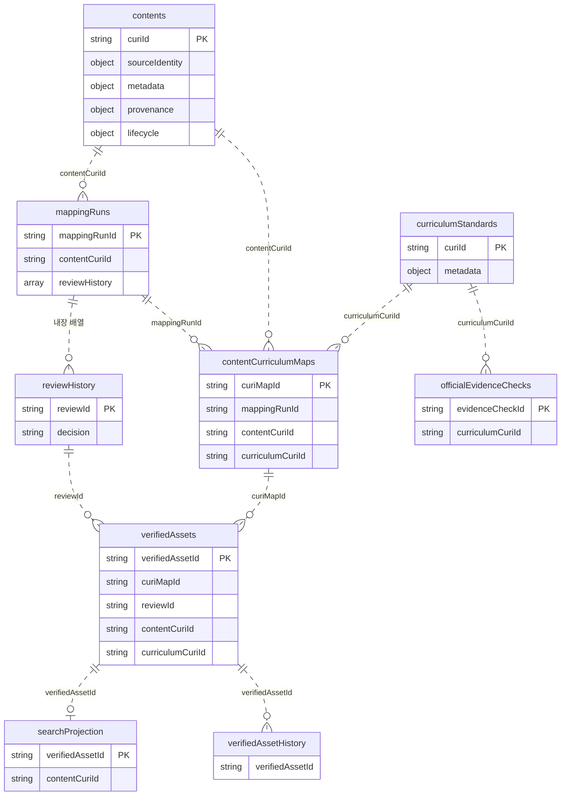
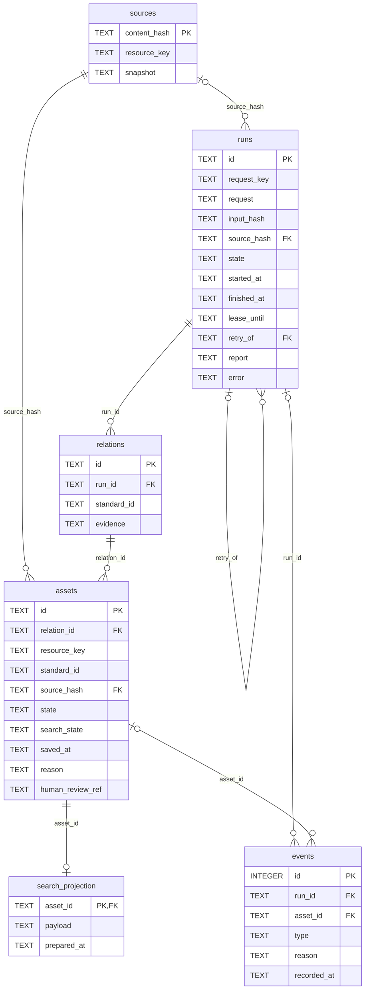
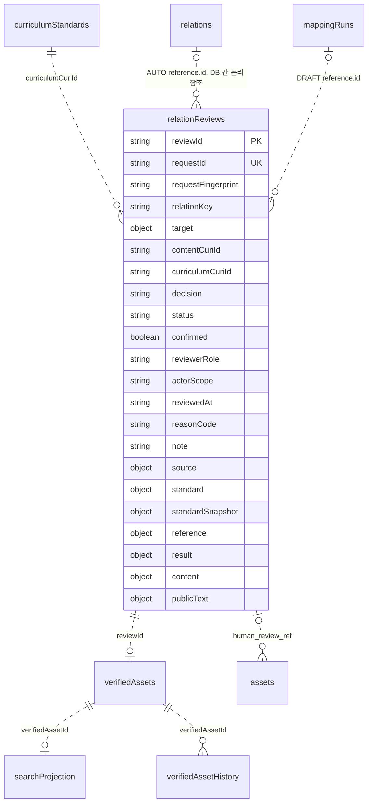

# Curi 저장 구조와 시맨틱 레이어 ERD

2026-10-05 R08-04 관계별 사람 결정·승인 자산 통합 저장, R07-01 검색 상태 및 R07-03 원문 보강 이력 기준. SQLite 테이블과 JSON 배열을 구분한다. 방송 후보가 승인 자산으로 자동 이동하는 관계는 없다. 아래 PK는 SQLite 실제 키이며, JSON의 PK 표기는 애플리케이션 식별자다.

[전체 저장 구조도](database-structure.svg) · [전체 구조 Mermaid 원본](database-structure.mmd) · [SQLite 테이블 관계도](database-relations.svg) · [테이블 관계 Mermaid 원본](database-relations.mmd)

## 1. 방송 원본: broadcast-catalog.sqlite

`identity`는 메뉴·시즌 URL이 달라도 동일 강좌/회차를 하나로 누적한다. 방송 원본은 ID를 보존하고 검색에서는 동일 프로그램·정규화 제목을 한 대표로 묶는다. `pages`는 수집 체크포인트이며 빈 페이지의 COMPLETE는 회차 확보 성공을 뜻하지 않는다. `link_checks`는 제목과 URL이 현재 원본과 일치할 때만 유효하다. 도착 페이지 일치와 영상 재생 확인은 별도다. FTS5는 저장되어 있지만 현재 탐색 엔진은 메모리 카탈로그를 사용한다.

프로그램 인벤토리는 별도 `broadcast-programs.json`이다. `courseId` 기준 공식 프로그램/시즌 목록이며 독립 방송 시리즈 수와 같다고 단정하지 않는다. 표시 회차 수는 확보 실적이 아니다.

`source_enrichments`는 R07-03의 공식 상세 원문 보강 시 생성된다. `record` JSON은 이전/다음 소개문·내용 지문·payload, 상세 페이지 대조 결과와 보관 원문 비교를 보존한다. `source_id`는 `episodes.id`의 논리 참조이며 SQL FK는 없다. 소개문 출처·확인 시각과 페이지 표기 재생시간은 `episodes.payload`에도 저장한다. 이 기록은 실제 영상 재생·장면·학년 적합성 확인을 뜻하지 않는다.

R08-09의 `episodes.payload.sourceSupplements[]`에는 공식 문서 유형·URL·제목·게시/확인 시점·회차 identity·식별 근거 문구·발췌·문서 문자 위치·응답 및 발췌 지문을 보존한다. `source_supplement_events(event_id TEXT PRIMARY KEY, resource_id TEXT NOT NULL, checked_at TEXT NOT NULL, record TEXT NOT NULL)`는 이전/다음 연결 기록을 저장하며 resource_id는 논리 참조다. 연결과 이력은 한 트랜잭션으로 저장한다. 회차 identity나 발췌 지문이 달라지면 해당 보조문서는 읽기에서 제외한다. 소개문 content_hash는 소개문 버전으로 유지하며 보조문서 지문은 별도다.

## 2. 구현된 시맨틱 스냅샷: semantic-layer.sqlite

태그는 검색 카탈로그의 대표 자료를 대상으로 만든다. `resources.id`는 방송 SQLite뿐 아니라 CSV·지리 JSON·기존 콘텐츠의 검색 ID도 포함하므로 방송 `episodes`에 SQL FK를 걸지 않는다. `content_hash`와 규칙 버전으로 근거 변경을 구분한다. `SOURCE_MENTION`은 제목/소개문에 해당 표현이 있다는 뜻이며 개념을 설명하거나 수업에 적합하다는 판정이 아니다. 상위 개념 후보는 기본 검색의 직접 일치에 사용하지 않는다.

`semantic-build.js`는 같은 규칙으로 전체 스냅샷을 임시 DB에 만든 뒤 교체한다. 현재 런타임은 원본 변경 시 새 카탈로그와 메모리 태그를 생성한다. 디스크 스냅샷은 감사·재현용이며 검색 때 읽는 벡터 DB가 아니다. 원문 변경 후 디스크 스냅샷은 빌드 명령으로 갱신해야 한다. 그래프 DB·신경망 임베딩·범용 언어 모델을 새 탐색에 연결한 것은 아니다.

## 3. 기존 승인 경로: curi-store.json의 논리 ERD

JSON 참조는 애플리케이션 계약으로 검증하며 SQLite FK가 아니다. `discovery-geography.json`의 개념·장소·자료 연결도 내장 배열의 `resourceIds`/`directResourceIds`로 관리한다. 이 지리 관계는 시맨틱 `concepts`와 별도 네임스페이스다. 로컬 `GET /api/curi/discover/context`는 검색 결과·직접 근거·추론 후보·미확인 조건을 최대 6자료·직렬화 24,000자로 묶으며 새 승인 데이터를 만들지 않는다.

## 4. 교사 개인 수업 준비: R07 localStorage

서버 JSON·SQLite에 새 테이블을 만들지 않는다. 같은 브라우저의 같은 origin(호스트·포트)에 저장한다.

| 키 | 실제 값 | 관계·확인 범위 |
| --- | --- | --- |
| `curi.discovery.shelf.v1` | 자료 배열: `id`, 제목·출처·근거 사본, `query`, `topic`, `savedAt`, `questions` | 기존 모음 유지, 최대 100자료. 개인 선택이며 승인 기록이 아님 |
| `curi.teacher.search.v1` | `q`, `grade`, `kind`, `access`, `place`, `program`, `page`, `curriculum`, `topic`, `sort`, `conceptGroup`, `concept`, `subject`, `description`, `year`, `from`, `to`, `standard`, `state`, `standardSubject`, `standardGrade`, `standardQuery`, `standardView`, `legacyScope`, `invalidConditions` | R07-08 선택 기준/관계 상태·기준 탐색·이전 주소/중복 오류 복원, R07-01 단일 목록의 검색/필터/정렬/페이지와 R09-01 수업 대상. 이전 `view`·`browse`는 무시하며 기존 검색 조건·모음·폴더를 보존 |
| `curi.teacher.folders.v1` | `folders[]`, `selectedId` | 최대 50개 수업 폴더, 선택한 폴더 유지 |
| `folders[]` | `id`, `title`, `note`, `topic`(이전 주제), `updatedAt`, `items[]` | 수업별 폴더. 같은 자료를 여러 폴더에 담을 수 있음 |
| 폴더의 `items[]` | `resource` 사본, `note`, 선택적 `legacy`(`role`, `question`, `activity`) | 폴더당 최대 100자료, 동일 자료 ID 중복 방지. 기존 발문·활동은 이전 기록으로 보존 |
| `curi.teacher.lesson.v1` | 이전 단일 준비안 `title`, `topic`, `note`, `updatedAt`, `items[]` | 이관 원본으로 읽기만 하며 삭제·덮어쓰지 않음 |

`resource.id`는 탐색 자료의 논리 참조이며 FK가 아니다. 한 폴더에서 빼거나 폴더를 삭제해도 다른 폴더와 자료 모음은 삭제하지 않는다. 새 저장 키가 없을 때만 이전 준비안을 하나의 폴더로 이관하며 새 키에 빈 폴더 목록이 있으면 다시 이관하지 않는다. 읽기 실패·다른 창의 저장 변경을 감지하면 덮어쓰지 않는다. 재열기·화면 복귀·내보내기 때 `/api/curi/discover/resources`로 현재 제목·소개문·링크·방송일·사람 승인·자동 관계를 다시 읽는다. 저장 사본의 통과 표시는 현재 대조 전 숨기며 조회 실패도 통과로 표시하지 않는다. 소개문은 재조회 시 현재 값으로 보완하고 현재 자료 식별이 맞지 않으면 제목 검색과 연계 미확인으로 안내한다. 다른 기기 동기화·계정 저장은 구현하지 않았다.

R07-01의 필터·정렬·카드 태그에는 새 서버 테이블을 만들지 않는다. `SOURCE_MENTION`과 현재 공개 원문에서 개념/교과/소개문 상태를 계산하고 기존 방송 날짜를 사용한다. 8개 탐색 묶음은 편집한 필터 분류이며 교육과정 관계가 아니다. 태그가 없으면 미분류로 남고 자유 검색 대상에서 제외하지 않는다.

방송 원본의 같은 제목 회차는 기본 카탈로그와 별개인 메모리 `searchVariants`로 보존해 교사 경로에서 ID별로 확장한다. 각 회차의 날짜/필터를 대조하고 정렬한 뒤 프로그램·유형·판본 표시를 정규화한 제목으로 묶는다. 화면 건수는 이 묶음 기준이며 날짜·승인 관계를 다른 회차에 복사하지 않는다. 기존 시맨틱 SQLite는 그 당시 기본 카탈로그의 감사 스냅샷으로 유지하고, 교사 검색의 현재 태그는 확장한 카탈로그에서 계산한다. 디스크 스냅샷과 실시간 분류 수는 같다고 주장하지 않는다.

R07-05의 자료 사본에는 `selectionContexts[]`를 최대20개 보존한다. 선택마다 기준 코드/문장·복수 courses·모호성·선택 시점·저장 당시 snapshot·수업 목표·활용 부분·추가 내용이 있으며 폴더별 개인 입력은 독립적이다. snapshot의 선택/수집 시점과 실제 검사 시점은 별도다. `assessments`의 difficulty/prerequisites/scenes는 `UNCONFIRMED` 또는 `PERSONAL_REVIEW`와 개인 메모·근거·확인 시점으로 저장한다. `decision`·`decisionReason`의 사용/제외/보류 이유도 개인 기록이며 실제 사람 승인과 무관하다. 기존 저장 키·메모·옛 단일 폴더 이관 원본을 보존한다.

R07-07 결합 검색은 저장 테이블이나 localStorage 키를 추가하지 않는다. 교사 API의 `standard`·`state`는 요청 조건이고, 응답의 `standard`·`searchMode`·`emptyReason`·`contextWarning`·`filters.state`는 현재 검색의 메모리 계산이다. 선택 관계만으로 `approvedLinks/automaticLinks`를 제한하고 다른 기준 이력은 `otherStandardLinks`에 분리한다. `curriculumComparison`·`curriculumRelevanceReason`은 공개 원문 비교이며 새 승인 자산이 아니다. 자료 `teachingContext.targetGrade/targetNeedsClarification`은 교사 대상이고 `courses/standardId/officialGradeBand`는 선택 기준의 관계 문맥이다. `selectedStandard`는 공식 원문/출처 사본이다. R07-07 단계에서는 기존 검색 저장 필드나 개인 자료를 변환하지 않았다. 화면 선택·복원은 R07-08에서 연결했고 개인 문맥의 후속 연결은 R07-09다.

## 5. 관리자 접근: R08 메모리 세션

관리자 목록은 방송 SQLite·검수 JSON·자동 자산 SQLite를 읽으며 별도 관리 집계 테이블을 만들지 않는다. `server/admin-auth.js`의 메모리 Map에 무작위 세션 ID와 절대 만료 시각을 저장한다. 브라우저 인증 정보는 HttpOnly 쿠키에 둔다. 로그아웃·만료·재시작 시 접근 권한을 제거하며 교사 localStorage와 승인 기록은 변경하지 않는다. 코드 로그인은 단일 운영자 MVP이며 개인별 행위자 식별 테이블은 없다.

R08-03의 `curi.admin.jobs.v1` localStorage에는 관리자가 명시적으로 선택한 최대 30건의 원본/콘텐츠 ID·제목·교과·작업 종류·실행 ID·건별 상태/메시지를 보존한다. 진행 중 창을 닫은 작업은 `UNKNOWN`으로 표시하고 재개 시 서버에 다시 요청한다. 이 값은 서버 검사·승인 기록의 근거가 아니며 교사의 폴더 저장 키와 분리한다. 서버는 재요청의 원본·입력 지문을 대조해 중복 저장을 막는다. 저장 출처 점검 결과는 이 임시 작업 목록에만 표시하고 새 승인 기록을 만들지 않는다.

목록은 원본 ID별 고유 자료 수를 세며 상태 필터끼리 중복될 수 있다. 후보 관계 수는 교과/학년별 최신 실행, 실행 수는 전체 보존 이력에서 계산한다. 최신 100개 API 제한과 분리하고, 후보가 0건인 보류·원본 없는 실패도 포함한다. 현재 출처·기준·규칙과 달라진 근거는 보존 당시 통과와 현재 제공 상태를 나눠 표시한다.

## 6. 자동 연계 자산: R08-02 automatic-assets.sqlite

`server/data/automatic-assets.sqlite`는 `PRAGMA user_version=1`인 별도 SQLite다. `CURI_AUTOMATIC_DB`로 로컬 경로를 지정할 수 있다. 방송·시맨틱 DB와 승인 JSON은 이전하거나 수정하지 않는다.

| 필드/경계 | 실제 내용 |
| --- | --- |
| `resource_key` | 출처 시스템·원본 ID·판본의 SHA-256. 제목·검색 대표 ID를 키로 사용하지 않음 |
| `sources.snapshot` | JSON: 출처/텍스트 URL·원본 ID·판본·원문 버전·제목/소개문·활성 상태·내용 지문 |
| `runs.request/input_hash` | 서버 원본 ID와 교과/학년 선택, 현재 원문·공식 목록·규칙·사람 결정의 입력 지문. 실행 중 같은 지문은 유일 인덱스로 중복 차단 |
| `runs.report` | 전체 검사 JSON·규칙 범위·후보 수·보류 이유. 후보 0건도 보존. 저장 실패 시 검사 보고서를 남기되 `relations`/`assets` 저장 성공으로 취급하지 않음 |
| `runs.error` | 원본 없음·검사 실패(`AUTOMATIC_CHECK_FAILED`)·자산 저장 실패(`ASSET_SAVE_FAILED`)·변경/임대 만료 등을 구분. 같은 입력 지문의 저장 실패 재시도는 보존 보고서로 저장만 다시 수행하며 현재 원본/기준/규칙도 대조 |
| `relations.standard_id/evidence` | 공식 `curriculumCuriId`의 논리 참조. JSON에 기준 원문·코드·출처 문서/쪽·지문, 인용문/UTF-16 위치/원문 지문, 연결/미확인 요구, 개별 검사·판정·시각을 함께 보존. `(run_id, standard_id)` 유일 |
| `assets.id` | 원문 지문·해당 기준 지문·규칙·검사 범위의 안정적인 자산 ID. 같은 버전 재검사는 현재 관계 참조를 갱신하고 이전 관계·실행·사건은 남김 |
| `assets.human_review_ref` | 자동 노출보다 우선한 기존 묶음 또는 새 `relationReviews.reviewId`의 논리 참조. 자동 실행이 새 사람 결정을 만들지는 않음 |
| `search_projection.payload` | 공개용 성취기준·인용·연결/미확인 부분·자동 검사 시각/규칙·`humanVerified:false`. 사람 메모·실행 입력 전체를 공개하지 않음 |
| `events` | 시작·중단·완료·실패·저장·검색 준비·무효화 이력. 실행/자산 FK와 이유·시각 보존 |

실행 상태는 `RUNNING`, `CHECKED`, `HELD`, `FAILED`, `STALE`, `INTERRUPTED`다. `CHECKED`는 검사가 수행됐다는 뜻이며 공개 가능 자산 수와 다르다. 자산 상태는 `CURRENT`, `STALE`, `BLOCKED`, `SUPERSEDED`, 검색 상태는 `PENDING`, `READY`, `FAILED`, `INVALIDATED`로 구분한다. 후보·근거·자산과 실행 완료는 한 트랜잭션으로 저장한다. 저장 후 검색 준비가 실패해도 앞선 저장은 유지한다. 중단된 실행은 임대 만료 후 다음 명시적 실행에서 중단 이력을 남기고 재개한다.

공개 읽기는 현재 자산을 원문·공식 기준·규칙·실제 사람 결정과 다시 대조한다. 변경이 발견되면 자산을 무효화하고 검색 투영을 삭제하지만 후보·인용·검사·사건은 삭제하지 않는다. 한 성취기준의 변경은 해당 관계에만 적용한다. 원본 삭제·식별 중복은 제공을 중단하며 일시적인 읽기 실패도 과거 통과를 응답하지 않는다. 유효 자동 자산이 제목 대표에 가려진 회차라면 그 원본 ID로 제공하고 다른 대표 회차에는 연결하지 않는다.

최초 실행은 새 DB만 생성한다. R08-03은 기존 스키마 v1·컬럼을 재사용하며 DB 이전은 없다. 버전 없는 기존 테이블이나 지원하지 않는 버전은 덮어쓰지 않는다. 백업은 `VACUUM INTO`로 일관된 사본을 생성하며 이미 존재하는 파일은 덮어쓰지 않는다. 복원은 서버/CLI 쓰기를 중지한 뒤 자동 DB만 교체하고, 재조회 시 현재 원본으로 다시 유효성을 판정한다. 명령과 확인 절차는 [R08-02](../Tasks/task-r08-02-automatic-assets.md)에 기록한다.

## 7. 관계별 사람 결정: R08-04 curi-store.json 확장

기존 JSON `schemaVersion: "1.4"`에 선택 배열 `relationReviews`를 추가한다. 최초 실제 결정 때만 이 배열을 저장하며 기존 4개 승인 자산·묶음 검토·무효화 이력을 일괄 변환하지 않는다. 방송·시맨틱 DB와 자동 SQLite v1의 스키마 변경은 없다.

| 필드/경계 | 실제 저장과 검증 |
| --- | --- |
| `relationKey` | 출처 시스템·원본 ID·판본·공식 기준 ID의 SHA-256. 제목·검색 대표 그룹·조회 학년을 사용하지 않음 |
| `target/contentCuriId` | 기존 콘텐츠 ID 또는 방송 원본 ID. 미가져오기 방송은 시스템/원본/판본 지문의 `RESOURCE-…` ID를 자산에 사용하며 `contents`에 자동 삽입하지 않음 |
| `requestId/requestFingerprint` | 같은 요청은 원래 결정 반환, 같은 ID의 다른 입력은 409. 조회 시 제공한 `expectedVersion`은 현재 원문·기준·관계 참조·최신 사람/묶음 결정과 저장 직전에 재대조 |
| `decision/status` | `approve/HUMAN_APPROVED`, `edit/HUMAN_EDITED`, `exclude/EXCLUDED`, `hold/HELD`. 최신 결정은 같은 관계 키의 마지막 기록 |
| `confirmed/reviewerRole/actorScope/reviewedAt` | 명시적인 실제 확인과 서버가 기록한 `LOCAL_HUMAN_REVIEWER`, `SINGLE_OPERATOR_SESSION`, 저장 시각. 개인별 실명 인증 기록이 아님 |
| `source/standard/standardSnapshot` | 원문 제목/소개문·출처/텍스트 URL·판본·활성 상태·지문, 공식 기준 원문·코드·버전·문서/쪽·지문. 원문 공유 관계와 개별 기준 변경을 구분 |
| `reference` | `AUTO`: 보존 자동 관계 ID/근거 지문, `DRAFT`: 기존 실행 ID/결과 지문, `CURRENT_SOURCE`: 현재 공식 목록과 원문에서 선택한 근거 버전. 자동 규칙만 바뀌어도 사람 승인을 취소하지 않으며 참조한 기존 초안 변경은 재확인 |
| `result` | 해당 기준 한 개, 정확한 인용/필드/UTF-16 위치, 연계 이유·수업 활용·핵심개념·연결/미확인 부분·`PARTIAL/FULL`. 변경한 필드만 제출하고 서버가 최종 결과를 구성 |
| `note/reasonCode` | 관리자 판단 사유. 교사의 공개 원문·인용과 별개이며 검색 공개 근거에 사유 메모 전체를 넣지 않음 |
| `verifiedAssets` | 실제 승인/수정에만 `reviewKind: RELATION_REVIEW`, `relationKey`, `reviewId`, 해당 원문/기준/판단 사본과 지문, `HUMAN_VERIFIED`를 저장. 제외/보류는 기록만 남기고 해당 승인 자산을 이력으로 이동 |
| `searchProjection/searchIndexRuns` | 해당 승인 자산별 검색 준비·벡터·실패. 다른 관계의 유효 투영을 보존하고 새 사람 결정 없이 검색 준비만 재시도 |

결정과 승인 자산은 같은 JSON의 임시 파일 쓰기·이름 교체로 함께 확정한다. 관리자 HTTP 쓰기는 단일 프로세스 잠금으로 직렬화하고 서비스 중복 실행도 거절한다. 외부에서 여러 서버/CLI를 동시에 실행해 같은 JSON을 쓰는 다중 프로세스 트랜잭션은 지원하지 않는다. 검색 준비는 JSON 저장 후 실행하므로 저장 성공과 검색 실패를 별도로 응답한다.

`readDataStore`는 현재 원문과 기준으로 승인 자산을 관계별 대조한다. 한 기준/판단 변경은 그 자산과 투영만 무효화하고 원문 변경은 공유 관계를 재확인한다. 방송 원본에서 판단한 자산도 현재 원본을 읽으며, 가져오기 후에는 보존한 판본의 현재 콘텐츠를 사용한다. 오래된 판단·초안·승인 자산의 이력은 삭제하지 않는다. 공식 기준이 삭제되면 해당 새 사람 판단의 과거 원문/기준 이력을 읽기 전용으로 제공한다.

자동 공개 경로는 기존 묶음 결정과 새 관계별 결정을 함께 읽고, 정확히 같은 원본/판본/기준의 최신 실제 판단을 우선한다. 제외·보류도 자동 재검사로 풀리지 않는다. 사람 승인과 자동 자산 사이에 새 실명/검토 시각을 복제하거나 자동 통과를 사람 승인으로 바꾸지 않는다.

브라우저 `sessionStorage`의 `curi.admin.review-pending.v1`은 응답 미확인 요청의 관계 키·원래 요청 ID·입력 사본만 임시 보존한다. 재열기 때 자동 저장하지 않으며 운영자가 같은 요청으로 결과를 재확인한다. 성공 또는 명시적인 입력 취소 때 제거한다. 이 값 자체는 승인 근거가 아니고 교사 localStorage와 분리된다.

## 후속 제안 — 아직 구현하지 않은 구조

태그별 검토 이력·개인별 운영자 계정, 관계 JSON에서 더 세분한 근거 테이블, 자동 갱신 스케줄, 프로덕션 모델의 실행·비용·인용 감사 테이블은 후속 범위다. 현재 ERD의 구현 테이블과 혼합하지 않는다. 기존 공식 교육과정의 ID는 유지하고, 시맨틱 편집 어휘를 공식 성취기준인 것처럼 대체하지 않는다.

근거 코드: [방송 저장](../server/broadcast-store.js), [검색 카탈로그](../server/discovery-catalog.js), [태그 규칙](../server/semantic-layer.js), [시맨틱 스냅샷](../server/semantic-build.js), [추론 근거 묶음](../server/semantic-context.js), [자동 자산 스키마](../server/automatic-asset-store.js), [자동 자산 실행](../server/automatic-assets.js), [현재 제공 검사](../server/automatic-asset-search.js), [사람 결정 저장](../server/human-review.js), [사람 근거 계약](../server/human-review-contract.js).

## 7. 공식 상세 원문 보강 이력 — R07-03·R08-05

방송 SQLite의 기존 `episodes`·`episode_text`·`link_checks`는 유지한다. `source_enrichments`는 공식 상세 재대조를 명시적으로 실행할 때 생성하며 이전 내용을 보존한다.

| 필드 | 내용 |
| --- | --- |
| `event_id` TEXT PK | 원문 변경/대조 사건의 SHA256 |
| `source_id` TEXT | 정확한 방송 회차 ID. 같은 제목 판본에 전파하지 않음 |
| `checked_at`, `status` TEXT | 공식 상세 확인 시점, UPDATED/UNCHANGED/INSUFFICIENT/MISMATCH |
| `record` TEXT JSON | 이전/현재 소개문·내용 해시·payload, 현재 상세 메타/응답 지문, 보관 감사와의 비교, 소개문 대조 여부 |

같은 회차의 소개문·`content_hash`·FTS와 `payload.summary/synopsisSourceUrl/synopsisCheckedAt`를 트랜잭션으로 갱신한다. 제목·ID·허용 출처가 다르거나 수집 중 원본이 바뀌면 반영하지 않는다. 제목 끝 `(수어)`·`(더빙)`·`(자막)` 표기는 기존 목록의 같은 표기와 제목 본문이 일치할 때만 허용하고 `payload.officialTitleVariant`에 대조 근거를 보존한다. 원문 부족으로 현재 소개문을 대체하지 않은 경우 대조 일치로 표시하지 않는다. 네트워크 실패는 실행 보고서에 남긴다.

`payload.durationSeconds/durationSourceUrl/durationCheckedAt`는 확인된 해당 페이지의 표기다. 재생 확인이나 다른 판본의 시간이 아니다. 목록 재수집에서 상세 원문·해당 메타데이터를 보존하며 링크 대조가 현재 제목/주소와 다르면 시간 표시를 숨긴다. `link_checks.detail`의 소개문을 현재 원문과 직접 대조해 상태를 표시한다.

다섯 원문 품질 상태·서비스 내용 안내·요청별 설명·교육과정 공백은 현재 원문에서 계산한다. 검색 중 새 사람 판단을 쓰지 않는다. 보강으로 원문 내용이 바뀌면 기존 자동/사람 관계의 현재 버전 검사가 그대로 적용된다. 시맨틱 SQLite는 이전 감사 스냅샷이며 런타임 태그는 현재 소개문에서 재계산한다.

R08-06의 기준별 실행은 자동 자산 SQLite v1 스키마를 바꾸지 않는다. `runs.request`와 입력 지문에 관리자가 선택한 `standardId`를 포함하고, 해당 기준과 교과·학년을 서버에서 검증한다. 한 원본에 여러 기준을 실행해도 `relations.standard_id`와 자산 지문이 각각 분리되며, 공개 `search_projection`은 전체 요구를 충족한 제한 규칙의 현재 관계만 가진다. 현재 실제 공개 자동 자산은 농경문 청동기–`6사04-01` 한 건이고 `human_review_ref` 없이 `humanVerified:false`로 제공된다.

## R09-01 학교급·과정 및 편성 근거

추가 서버 테이블은 만들지 않는다. curi-store.json의 curriculumStandards에136개를 병합하여214개를 보유한다. 기존78개와 그 검수 스냅샷은 변경하지 않는다.

| 저장 위치 | 의미 |
| --- | --- |
| 신규 기준 metadata.schoolLevel/gradeBand/courseId | 학교급·국가 교육과정 학년군·서비스 적용 과정. 중1은 중학교/1~3학년군/middle1 |
| 신규 기준 source | 공식 문서명·로컬 PDF·PDF/인쇄 쪽·원래 코드·추출문·문서 SHA·코드+본문 SHA |
| 신규 기준 review/provenance | SOURCE_CHECKED/SOURCE, 에이전트 원문 대조. humanConfirmed:false; 실제 사람 확인·관계 승인이 아님 |
| 중1 기준 placement | 뉴런 교재·개념 강좌 ID/판본/대상표기/단원/강의구간/URL/확인일/버전. REFERENCE_MAPPED, schoolPlacementConfirmed:false |
| curriculumExpansion | 병합한136개 출처 자료의 버전·적재 시각. 사람 확인 수행 여부false |
| 기존 officialEvidenceChecks | 기존 공식 원문 대조 이력78행. 신규 기준의 SOURCE_CHECKED136개와 별도 집계 |
| 초안 content.curriculumGradeBand | 요청한 수업 과정. 기존 content.gradeBand 원본 Seed와 별도 보존 |
| 자료 teachingContext / 폴더 targetGrade | 선택한 수업 학년·과정·교과·기준. 원본 콘텐츠 메타데이터나 적합성 판정으로 승격하지 않음 |

신규 기준의 자동/사람 스냅샷에는 과정·공식 출처 대조 상태·편성 버전을 포함한다. 공식 본문·편성 변경은 해당 관계의 현재 유효성에 반영하며 이전 이력은 보존한다. 기존 기준 스냅샷 형식은 바꾸지 않아 추가 데이터만으로 기존 승인을 무효화하지 않는다. 후보 수는 자료×기준 관계 수와 원본 ID 고유 수를 구분하고, 현재 사람 승인·자동 공개는 후보 단어 매칭 여부와 독립적으로 집계한다.

R07-08은 기존 `curi.teacher.search.v1`에 선택 기준·관계 상태와 브라우저 전용 목록 조건을 추가했다. 목록 교과/과정은 자료 교과·수업 대상과 독립이다. 기존 저장값에 새 필드가 없으면 빈 기준/전체 과정으로 읽으며 개인 자료·폴더를 이관하거나 삭제하지 않는다. `legacyScope`는 이전 교육과정 주소의 범위 충돌 대조, `invalidConditions`는 중복 주소 오류의 새로고침 보존용이다. 서버 저장 테이블을 추가하지 않았다.

검색 관련 기준 추가 수정은 기존 검색 키의 `standardView`(관련/전체 보기)만 추가한다. `/api/curi/curriculum/related`의 `related/reason/total/method`는 공식 기준과 질문의 로컬 어휘 대조 결과로 새 관계·승인 자산을 저장하지 않는다. 후보 표시는 수업 대상이나 개인 자료/폴더를 변경하지 않는다.

R07-09는 기존 자료 사본의 `selectionContexts`에 `targetGrade/targetNeedsClarification`을 선택 당시 교사 대상으로 보존한다. `courseLabel/officialGradeBand/courses`는 공식 기준의 과정이며 대상이나 실제 영상 적합성으로 대체하지 않는다. 기존 문맥은 빈/미기록 대상 값으로 읽으며 snapshot·개인 목표/확인·폴더별 메모를 유지한다. 같은 기준의 서로 다른 대상은 복수 선택 이유로 보존한다. 새 localStorage 키·서버 테이블·클라우드 저장은 없다. 원문 재조회/현재 승인 대조와 저장 당시 비교 표시는 별개이며 화면 갱신·내보내기 동안 개인 입력을 현재 상태 응답으로 덮어쓰지 않는다.

## R07-10 공식 안내 파생 JSON

`server/data/curriculum-guidance.json`은 기존 DB와 독립된 읽기 전용 원문 안내다. `documents`는 원문 경로/SHA, `units`는 73단원·214기준 대응과 개별 `explanations`/단원별 `application`, `placement`는 중학교 총론의 세 편성 인용을 보관한다. 인용에는 문서/위치·추출 문자 오프셋·본문·`CURRICULUM_GUIDANCE_ONLY` 목적이 있다. 개별 해설이 없는 43기준의 값은 null로 유지한다.

요구 계획에 `guidance`·`placementGuidance`, 선택 기준 비교에 `guidance`가 추가된다. 공식 본문/판본 불일치에는 안내를 제공하지 않는다. 중1 참고의 `officialBand`는 중1~3, `schoolPlacementConfirmed`는 false다. DB 테이블·사람 승인·자동 자산·브라우저 개인 저장 키와 일반 내 자료의 요청 비교 갱신 방식은 변경하지 않는다.

## R07-12 요청별 프로그램·장르 표현

검색 응답의 `understanding.requiredPrograms`와 `preferences.programs/genres`, `constraints.requiredGenres/excludedGenres/excludedPrograms`는 현재 자연어 요청을 반영하는 실행 문맥이다. 자료 응답의 `genreEvidence`는 `{label,field,quote,start,end,status}` 형식의 공개 표현 근거이며 강의 자료 유형에는 오프셋 없이 RESOURCE_TYPE을 사용한다. TEXT_CUE는 실제 영상 장르를 확정하지 않는다. 기존 테이블·공식 기준·승인 JSON·자동 자산·개인 저장 키에 새 장르 분류를 적재하지 않는다.

## R07-13 파생 프로그램 분류·형태 근거

카탈로그 자료/판본의 `programClassification`은 `{forms,program,category,courseId,stepId,sourceUrl,sourcePage,checkedAt,sourceRecordHash,match}`다. 기존 공식 목록과 이름/식별자가 일치하는 경우에만 계산하며 저장 테이블을 추가하지 않는다. 목록 파일 변경은 카탈로그 캐시를 갱신한다.

요청 `constraints.genreOperator`는 AND/OR를 보관한다. 기존 `genreEvidence`의 실제 선언/전달 방식 근거는 FORMAT_DESCRIPTION, 기존 강의 자료 유형은 RESOURCE_TYPE, 공식 프로그램 분류는 OFFICIAL_PROGRAM_CATEGORY다. 공식 분류 근거의 `field`는 programCategory이며 `sourceText`·출처/쪽·확인 시점·원본 레코드 SHA를 제공한다. 회차 텍스트 근거의 오프셋은 원문 그대로 유지한다. R07-12의 TEXT_CUE 기반 비교는 이 구분으로 보강했다. 공식 분류/형식 근거는 영상의 전수 장면 확인이나 교육과정 승인이 아니다.

## R07-14 표시용 내용 키워드

자료 응답의 contentKeywords는 `{label,kind,conceptId?,evidence:{field,start,end,quote,sourceUrl}}` 배열이다. SOURCE_KEYWORD는 표시용 원문 표현, REGISTERED_CONCEPT는 기존 직접 등록 개념이다. coreTags 응답의3개 상한은 제거하고 카드에서8개+추가 펼치기로 제한한다. 키워드를 원본/시맨틱 DB·자동 관계·사람 승인에 새 태그로 적재하지 않는다. 기존 등록 개념 없음 필터의 의미와 개인 저장 키는 유지한다.

## R07-15 소개문 근거 키워드

contentKeywords의 evidence에 `context` 근거 문장을 추가한다. field는 `summary`로 한정하며 start/end/quote는 원본 소개문과 일치한다. REGISTERED_CONCEPT는 기존 개념 사전 대표 어휘를 소개문에서 다시 확인한 표시이며 기존 coreTags의 제목 근거를 그대로 합치지 않는다. SOURCE_KEYWORD는 선별된 단원 탐색 어휘·원문 소재다. 불확실한 의미는 배열에서 제외한다. DB 태그/자동 관계/사람 승인·개인 저장 키의 변경은 없다. 기존 검색용 coreTags와 화면 표시 태그 수는 일치하지 않을 수 있다.

## R07-16 방송 안내·공식 소개 복구

contentPreview에 issues(TRUNCATED_END/UNFINISHED_END/ENCODING_DAMAGE)·reviewNote를 제공한다. evidence는 원본 summary의 field/start/end/quote이며 표시 text 정리와 구분한다. 짧은 설명 표시는 sourceQuality PASS나 교육과정 승인이 아니다. 방송SQLite의4회차 synopsis/payload/내용해시·FTS·link_checks와 기존 source_enrichments 이력을 갱신했다. 승인JSON·시맨틱DB·자동자산DB는 유지한다. 공식 대조/변경 전후 해시는 docs/r07-16-official-source-applied.json에 기록한다.

## R07-17 전체 문맥 색인 재생성

검색 SQLite의 resources는 대표/판본23,360건이다. 기존 tags는 소개문에 근거한 SOURCE_MENTION848행/INFERRED_CANDIDATE51행으로 재생성한다. 제목만으로 확정하지 않으며 원문의 start/end/quote를 보존한다.

- context_reviews: resource_id(PK/FK), source_status, meaning_review, record(JSON). 전체자료의 후보별 채택/보류·원문 상태와 RULE_SCREENED_NOT_MODEL_VERIFIED를 저장한다.
- source_keywords: resource_id(FK), label, kind, concept_id(선택FK), field, start, end, quote, source_url, context. PK(resource_id,label)·label색인, 검증된3,904표시/검색 어휘다. 등록 개념 어휘와 중복될 수 있다.

원본 방송DB·승인JSON·자동자산DB는 변경하지 않았다. buildId에는 규칙 파일 SHA와 자료 지문이 들어간다. 변경 전후SHA/보호3저장소SHA는 docs/r07-17-index-applied.json, 자료별 전수 판정은 r07-17-context-audit.ndjson에 기록한다. 과거R07-15의 검색 보존 범위는 이번 요청으로 검색/필터 반영까지 확장되었다.

## R07-19 재생성 가능한 방송 의미 검색 색인

`server/data/broadcast-semantic-search.sqlite`는 기존4저장소와 분리하며 Git에서 제외한다. 원본·공식 기준·태그·승인 자산의 정본이 아니다.

| 테이블 | 키·필드 | 용도 |
| --- | --- | --- |
| metadata | key PK, value | 고정 E5 모델/문서 표현 버전 지문 |
| passages | (resource_id, field, start) PK; source_key, end, quote, vector BLOB | 자기 회차의 제목/소개문 구절과384차원 정규화 Float32 벡터 |

source_key는 회차ID/제목/소개문/근거URL의 SHA256이다. 읽을 때 현재 자료의 지문을 대조하며 다른 회차/변경 전 원문은 후보에서 제외한다. field/start/end/quote는 원문 UTF-16 위치와 정확한 slice를 따른다. 벡터는 검색 유사도이며 관계 설명/교육과정 승인으로 저장하지 않는다. 빌드는 `.building`에서 재개 후 완성본을 원자 교체한다. 런타임은 키/파일 변경에 따라 결과 캐시를 무효화한다.

## R07-19 요청 해석 연결의 비저장 데이터

입력 봉투·시스템 선택 조건·전달 해석·검색 계획·요구별 MATCH/MISMATCH/UNKNOWN은 요청 메모리와 HTTP 응답에만 존재한다. `server/data/request-*.schema.json`은 검증용 파일이며 DB 테이블이 아니다. 기존4저장소와 재생성 가능한 의미 검색 SQLite의 스키마/행은 변경하지 않는다. 원문 조건 일치는 영상/교사 적합성 또는 승인 자산으로 저장하지 않는다.

## R07-21 실제 원문 보강

23,360회차 수를 유지하고 episodes9행만 변경했다.4회차의 synopsis/payload/content_hash·FTS와 link_checks/source_enrichments를 갱신하고 다른5회차 payload.sourceSupplements와 source_supplement_events에 공개 자막을 별도 연결했다. 발췌 위치/공식 회차 선언·자막 참조/시간 위치/해시는 `docs/r07-21-official-caption-audit.json`에 보존한다. 재생성 의미 검색 SQLite는 변경된4소개/제목의8구절을 갱신했다. 기존 승인JSON·시맨틱 태그SQLite·자동자산SQLite는 유지한다. 보조 원문의 주제 태그는 현재 메모리 검색에서만 검사하며 관계/영상 승인으로 저장하지 않는다.

## R12 명시 제안과 개인 목표

link-proposals.sqlite의 proposals(id PK,status,created_at,record JSON)는 별도 검토 접수다. record는 영상/판본·기준/교육과정 판본·요구·원문 인용/위치/출처·원문/기준 지문·이유·확인 시점을 저장한다. PENDING/IN_REVIEW/REJECTED를 사용하고 사람 승인/자동 자산/검색 투영을 변경하지 않는다. 기존 관계 검토를 조회·재사용하며 원문 변경 시 검토중 전환을 거절한다. 개인 브라우저의 selectionContexts에 curriculumVersion/goalRequirements/usePurpose, 폴더에 lessonGoal을 추가했다. 기존 키/레코드·개인 메모는 보존하며 명시 제출에 개인 목표/구간/메모를 보내지 않는다.

## R12-07 개인 수업용 구간

`curi.teacher.segments.v1`은 동일 Curi origin의 localStorage에 저장하는 별도 `{revision, records}`다. 기존 shelf/folders 레코드를 수정하지 않는다. records의 논리 키는 id이며 resourceId는 기존 자료 ID, folderId는 기존 폴더 ID(빈 문자열은 내 자료)다. sourceUrl/variant는 회차·판본 대조, name/note는 개인 이름·메모, start/end/duration은 초 단위 시간, capture는 PLAYER/MANUAL, player는 EBS_JISIKE_HTML5, createdAt/updatedAt은 기록 시점이다. 폴더/자료 참조에는 DB FK가 없으며 저장·재생 시 현재 개인 목록/회차를 재확인한다. 삭제한 폴더의 구간을 다른 폴더에 자동 재연결하지 않는다.

Chrome 확장의 storage.local에는 curiOrigin과 `draft:<회차 식별>` 입력이 있고 storage.session의 `play:<탭 ID>`는 회차 재열기의 단기 제어 요청이다. 미디어 서명 URL·쿠키·계정 정보는 보존하지 않는다. 서버 DB·교육과정 승인/자동 자산과 별개다.

## 개인 폴더 교육과정 다중 연결 — R12-05

브라우저 `curi.teacher.folders.v1`의 folders[].curriculumStandards는 개인 수업 폴더의 다중 교육과정 스냅샷 배열이다. 각 값은 id/text/subject/courseId/courseLabel/gradeBand/curriculumVersion을 보존한다. 자료는 기존 resource.selectionContexts에 기준별 개인 선택 이유를 보존·추가한다. 폴더 기준과 자료 기준은 독립적이며 서버 승인 관계나 새 DB가 아니다. 기존 키/기준/메모/구간 원본은 유지한다.

## 확장 교사 등록 영상 — R12-08

저장소: `server/data/teacher-resources.sqlite` (런타임 자료, Git 제외).

| 테이블/열 | 역할 |
| --- | --- |
| teacher_resources.identity TEXT PRIMARY KEY | EBS courseId:stepId:lectId 회차별 중복 방지 |
| resource_id TEXT NOT NULL | 보유 원본 ID 또는 신규 TEACHER- ID |
| created_at TEXT NOT NULL | 등록일, 방송일로 사용하지 않음 |
| resource TEXT NOT NULL | 검색 자료 JSON: 제목/프로그램/공개 소개문/정규화 회차 URL/길이/원문 재대조 상태 |

교사가 등록한 영상은 일반 검색 자료이며 사람 승인 자산이 아니다. 기존 승인·자동 자산 테이블은 변경하지 않는다. 수업 폴더/구간은 기존 localStorage에 논리 ID로 연결된다. 서버 영상 등록과 브라우저 개인 저장은 서로 다른 저장소이므로 개인 저장 실패 시 CuriBase 성공 여부를 구분해 안내하고 재시도로 중복 없이 복구한다.

### 개인 자료 통합 화면의 가상 위치

전체 자료 화면은 기존folders와shelf를읽어 묶으며 새 통합 DB/저장 키를 만들지 않는다. `__unfiled__`는 화면에서만 사용하는 폴더 미지정 가상 위치로 실제 구간folderId는 기존 빈 문자열을 사용한다. shelf 항목의추가개인메모는personalLibraryNote에 저장하며 이전note를 보존한다. 전체 보기의묶음은ID·제목·판본이 같을때의표시이고 위치별 기준·선택 이유·메모·구간의병합이 아니다.

완료 안내용 localStorage `curi.teacher.extension-save.v1`과 Chrome `lastSave`는 등록 응답의 폴더/자료 ID·확인된 notice·origin/identity·savedAt을 보관한다. 영상/구간 정본을 대체하지 않으며 마지막 저장 결과를 표시하는 용도다.

## NEWS 클립·회차 미공개 프로그램 — R12-02

기존episodes 테이블의EBS:course:lect identity에NEWS기사페이지에서읽은course/step/lect를대조해저장한다. URL은newsAllView/lect/H 원본경로이며임의query ID를붙이지않는다. variant=NEWS_CLIP·payload.newsIdentity/publishedDate와본문출처/확인시각을보존하고검색에서는kind=clip/sourceSystem=EBS_NEWS다. 게시일과broadcast_date(null)를구분한다. link_checks MATCHED는기사제목/경로/스크립트ID대조이며실제재생/교육과정승인이아니다. 새테이블은없다.

공개회차가없는공식발표는broadcast-programs.json의publicationStatus/announcement 원문·URL·예정일에서collection 자료로구성한다. episodes/승인저장소에가상회차를추가하지않는다.

2026-10-15 사용자 삭제 요청으로 NEWS_CLIP76건과 해당 FTS·링크대조·시맨틱/의미검색 색인을 제거했다. 현재 CuriBase NEWS 클립0건이며 위 NEWS 저장 계약과 수집 기록은 당시 구조/결과다. 수집 체크포인트의 count는 과거 수집량이며 현재 보유량이 아니다. 개인 브라우저 사본과 다른 방송/교사 등록/승인 기록은 유지했다. [삭제 기록](r12-02-news-removal.json).

## R12 자연 다큐 보조 설명·공식 형태 선언 — 2026-10-15

기존 episodes.payload.sourceSupplements/source_supplement_events에175회차의 공식 보도자료를 연결했다. 기본 synopsis와 별도이며 identity(회차/프로그램/목록 방송일/판본/URL)·발췌 위치·문서/응답 해시를 유지한다. 자연 다큐196소개 갱신은 기존 source_enrichments/episode_text 경로를 사용한다. DB 테이블·승인/개인 저장 키 변경은 없다. 태그/문장 의미 파생 SQLite는 새 원문에 맞춰 재생성했다.

broadcast-programs.json의 선택 배열 programFormats는 name/courseId/stepIds/form/quote/sourceUrl/publishedAt/checkedAt/responseHash/contentHash를 저장한다. 공식 프로그램 소개의 장르 선언이며 기존 programs 목록/주제 분류를 덮어쓰지 않는다. 이름·강좌·단계·인용 지문이 일치할 때만 programClassification.formatEvidence로 제공한다. genreEvidence의 field는 programFormatEvidence, status는 OFFICIAL_PROGRAM_DECLARATION이며 sourceText/quote/출처/확인 시각/지문을 포함한다. 보조 원문 의미/내용 안내는 sourceSupplement 필드와 supplementId를 사용하며 오프셋은 해당 보조 발췌에 대응한다.

## R12-15 폴더별 수업 영상 순서

기존 localStorage `curi.teacher.folders.v1`의 folders[].videoPlaylist는 선택적 구간 ID 문자열 배열이다. 배열 순서가 활용 순서이며 동일 ID는 한 번만 담는다. 기존 폴더는 필드가 없으면 빈 리스트로 시작하며 읽기만으로 저장하지 않는다. 논리 참조는 `curi.teacher.segments.v1`.records[].id이며 구간의 folderId와 현재 폴더/자료 소속을 대조한다. 구간 이름·시간·메모는 원본을 실시간 조회하며 복제하지 않는다. 총길이는 유효하게 연결된 각 구간의 end−start를 밀리초 정수로 합산한 화면 파생값이며 별도 저장하지 않는다. 삭제되거나 자료가 빠진 참조는 사용할 수 없음으로 표시·합계에서 제외하고 명시 제거를 제공한다. 폴더 삭제 시 배열도 폴더와 함께 삭제되며 다른 폴더의 순서·구간은 유지된다. 기존 폴더 저장의 다른 창 충돌 검사·저장 실패 시 이전 값 유지 계약을 따른다.

## 공식 소개 별도 보충 — R12-02 (2026-10-15)

방송 SQLite에 `source_description_patches(resource_id TEXT PRIMARY KEY, record TEXT NOT NULL)`와 `source_description_patch_events(event_id TEXT PRIMARY KEY, resource_id TEXT NOT NULL, record TEXT NOT NULL)`를 추가한다. resource_id는 검색 카탈로그 ID이며 원본 ID·제목·프로그램·주소·소개를 묶은 identityHash로 연결한다. 소개 원본이 바뀌면 기존 보충은 적용하지 않는다. record는 identity/identityHash, 공식 sourceUrl/sourceKind, 실제 description/sourceText, responseHash/checkedAt/contentHash를 보존한다. sourceKind는 공식 목록·시리즈 소개·영상 메타·완결 문장 발췌를 구분한다. 발췌는 excerptStart/excerptEnd로 sourceText의 정확한 부분 문자열을 가리킨다. 이벤트 record는 previous/next다. 파일 밖 원본·승인 JSON·교사 등록 테이블과의 강제 외래키는 만들지 않으며 읽기 시 지문과 발췌를 검증한다.

방송 회차의 전체 공식 소개는 기존 episodes.synopsis/episode_text와 source_enrichments 전후 이력에 반영한다. 목록 보충은 같은 courseId/stepId/lectId와 제목·현재 해시·공식 목록 본문 포함 여부를 대조한다. 표준 주소 보충은 실제 확인한 synopsisSourceUrl을 payload에 저장하고 기존 row.url/link_checks는 보존한다. 발췌 보충은 episodes의 잘린 원문을 그대로 유지하며 카탈로그 표시/검색 시 별도 보충을 적용한다.

## 누락 키워드 보충의 원문 위치 — R12-25

`contentKeywords[].evidence.field`는 `summary` 또는 검증된 `sourceSupplement`를 사용할 수 있다. 후자는 `supplementId`·`contentHash`·`sourceUrl`와 해당 보조 원문 내부의 UTF-16 `start/end/quote/context`를 보존한다. 대표/판본은 각 ID의 원문을 따로 대조한다. 소개문 없음/제목 복사는 키워드를 임의 생성하지 않으며 검증된 보조 원문이 있는 경우만 보충할 수 있다.

파생 `semantic-layer.sqlite.source_keywords`에는 `supplement_id TEXT`·`content_hash TEXT`가 추가됐다. `field=sourceSupplement`인 행은 해당 보조 자료의 위치를 가리키고 `field=summary`인 행은 기존 소개문 위치를 유지한다. 기존 개념 태그·원천 방송·자동 자산·사람 승인/취소·개인 수업 저장 구조는 변경하지 않는다. 재생성 시 기존 SQLite를 임시 파일에서 완성·무결성 확인 후 교체한다.
