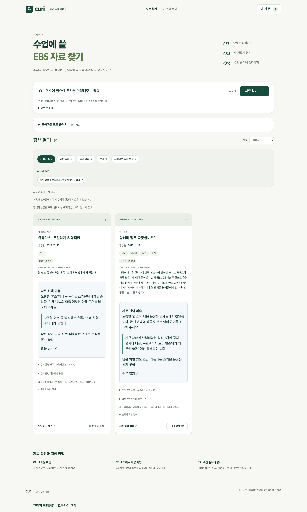

# R12-04 UX 검토 결과와 수정 지시

2026-10-14. **현재 제품을 직접 검토해 수정 지시를 정리했다. 제품 화면 반영은 아직 하지 않았다.** 에이전트의 대리 UX 검토이며 실제 교사 사용성 평가가 아니다. 기존 외부 정적 프로토타입 크리틱을 현재 화면에서 관찰한 문제와 섞지 않았다.

## 관찰 범위와 이미 동작하는 부분

현재 제품 코드·실제23,360자료·로컬E5 복제 서버에서1440×1000/390×844를 확인했다. 사회 ‘다문화’와 과학 ‘연소에 필요한 조건을 설명해주는 영상’, 동물 비교0건을 사용했다. 결과/카드/원문 링크/내 자료/폴더 생성·가져오기·재열기, 기본Tab 접근, 로딩/인위적 네트워크 실패·재시도, 격리된 저장공간 실패를 관찰했다. 보충 검토는 실행 중인 로컬 서버의 읽기API와 새 브라우저 저장공간을 사용했다.

현재 화면에는 선택 이유·원문 인용·남은 확인·회차 열기·개인 수업 목표/사용·제외 이유가 이미 구현돼 있다. 이런 기능이 없다는 과거 프로토타입의 지적을 반복하지 않는다. 이번에는 **그 정보를 이해하고 자료를 비교·선택·저장하기 쉬운지**를 검토했다.

- 본 관찰에서 가로 넘침과 페이지JavaScript 오류는 없었다.
- 내 자료→폴더 가져오기·새로고침/재열기와 개인 목표/활용 부분 입력 보존은 동작했다.
- 저장공간 실패는 실패/현재 입력 보존·재시도/내려받기로 안내됐다. 문제없는 복구 경로는 유지한다.
- EBS 외부 링크의 실제 도착/재생·영상 장면은 이번에 확인하지 않았다. 내부 링크 href 확인과 기존 출처 대조 상태만 기록했다.
- 폴더의 ‘현재 상태 재확인 중’ 캡처는 비동기 갱신 도중의 상태다. 영구적인 멈춤으로 판단하지 않았다.

[화면·행동 기록](r12-04-ui-observations.json), [개인 기록/포커스/저장 실패 보충](r12-04-ui-extra.json), [수정 지시 원본](r12-04-ux-instructions.json)에 근거를 보존했다. 사용자의 기존 개인 브라우저 저장값과 원본 자료는 변경하지 않았다.

## 수정 지시 — 먼저 반영할 순서

| ID·우선순위 | 관찰한 문제 | 수정 지시 | 확인할 결과 |
| --- | --- | --- | --- |
| UX-01 · 필수 |0건인데 ‘관련 자료를 찾았습니다’ 안내. 빈 결과 행동은 전체 목록 보기 |결과 상태를 일관되게 표시하고 질문 유지·조건별 수정/해제 경로 제공 |0건/오류/미확인 구분, 임의 조건 완화 없음 |
| UX-02 · 필수 |첫 카드y=999(데스크톱)/1,015(모바일), 검색 후 포커스가 제출 버튼에 남음 |검색 후 상단을 압축하고 결과/빈 결과 이유에 빠르게 접근하도록 정리 |390px 첫 화면에서 후보 제목/빈 결과 이유 확인, 키보드 결과 접근 |
| UX-03 · 필수 |모바일 연소 카드899/1,019px, 내용 안내·선택 이유 중복, 관계 미확인보다 주제 일치 강조 |기본은 내용·요청 근거·남은 확인·다음 행동. 중복/이력/원문 전체는 상세로 정리 |필수 내용 미확인 보존, 같은 후보 비교의 스크롤/시간 감소 |
| UX-04 · 필수·검색 연계 |연소 추가 검색어가 있는데 주제 없음 안내. 제외/선호 해석 확인 어려움 |주제/내용 요구/필수·제외/선호/미지원 조건을 명료하게 표시 |R12-03의 올바른 해석을 표시, 화면에서 조건을 추측하지 않음 |
| UX-07 · 필수 |근거의 원문 열기는 목록일 수 있고 회차 열기는 카드 맨 아래 |기본 확인은 해당 회차, 소개문 목록 출처는 명시한 보조 행동 |회차/소개문 출처 구분, 실제 재생 완료로 오표시 없음 |
| UX-05 · 필수 |내 자료→폴더→가져오기→담기·닫기 경유 |내 자료 보관을 유지하면서 기존 폴더에 바로 넣는 경로 제공 |기존 폴더에 카드에서2회 선택 이내 저장, 복수 수업/이유·기존 기록 유지 |
| UX-06 · 필수 |선택 이유를 펼치면 기준/학년/스냅샷 이력이 목표 입력보다 앞섬 |목표·활용 부분·선택/보류 이유 우선, 공식/당시 이력은 상세 |입력 위치 발견·재열기 보존, 교사 미입력 목표/장면 생성 없음 |
| UX-08 · 후속 |검색 실패시 Failed to fetch 노출 |짧은 한국어 안내, 세부 오류는 보조 상세 |재시도/현재 질문 보존과 저장 실패 안내 유지 |

이 지시는 **R12-05가 반영할 정리본**이다. 필수/후속은 작업 우선순위이며 제품 효용이 검증됐다는 뜻이 아니다. R12-03의 해석·근거가 필요한 UX-03/04는 그 실제 응답 계약과 함께 반영한다. 화면의 문구만 고쳐 관계 근거가 생긴 것처럼 표시하지 않는다. 사용자 수정 의견이 있으면 지시 원본에 먼저 반영한다.

## 화면 근거

[연소 데스크톱](r12-04-science-desktop.png)·[연소 모바일](r12-04-science-mobile.png)에서 ‘필요 조건: 대응하는 소개문 문장을 찾지 못함’이 이미 보인다. 필요한 수정은 이를 없애는 것이 아니라 요청 충족/부분/미확인을 기본 상태로 구분하고 반복 설명을 줄이는 것이다.

[동물 비교0건](r12-04-empty-mobile.png)에서는 ‘관련 자료를 찾았습니다’와 ‘일치하는 자료가 없습니다’가 함께 나온다. 데이터 부족 원인은 현재 결과만으로 알 수 없다는 설명은 유지하되 다음 행동을 조건 단위로 제공해야 한다.

[폴더 선택 이유 편집](r12-04-folder-context-mobile.png)에서는 실제 목표/활용 부분보다 공식 기준·학년군·선택 당시/현재 기록이 앞선다. 본 관찰에서 입력한 개인 목표/활용 부분은 재열기 후 그대로 남았다. 저장 기능을 재구축하기보다 입력과 확인 순서를 개선한다.

## 데이터/검색 트랙과의 경계

- 연소 조건/낮밤 발생 원리를 설명하는 자료가 부족한 문제는 R12-02/03 책임이다. 카드 높이를 줄여도 그 원문 공백이 해결되지는 않는다.
- 전투 제외·인터뷰 선호 해석 오류는 R12-03 책임이다. UX-04는 해석을 확인·수정할 수 있게 하는 책임을 맡는다.
- UX 전후는 고정 후보/순위로 비교한다. 새로 좋은 자료가 수집된 효과를 UX 성과로 합산하지 않는다.
- 실제 교사 선택 시간·포기율·반복 사용은 아직 미측정이며 R12-06에서 확인한다.

보류: 브랜드/색상 전체 재디자인·수업안 자동 생성·영상 장면 자동 요약·학년 적합성 자동 판정. 지금 관찰한 선택 장애를 해결할 근거가 없어 우선 범위로 확대하지 않는다.

## 사용자 결과 확인

- [ ] 실제 현재 화면 근거와 에이전트 대리 검토의 한계를 확인한다.
- [ ] UX-01~08의 필수/후속 지시와 검색/데이터 의존을 확인한다.
- [ ] R12-05에서 기존 기능/기록을 유지하면서 반영할 확인 기준을 검토한다.
